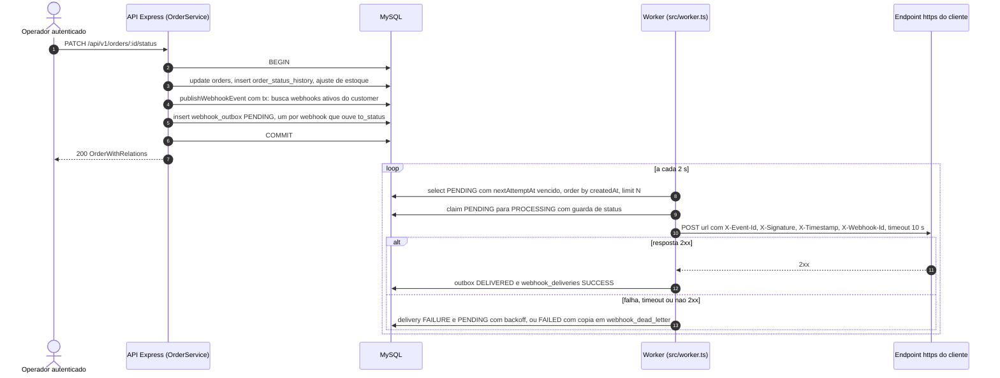
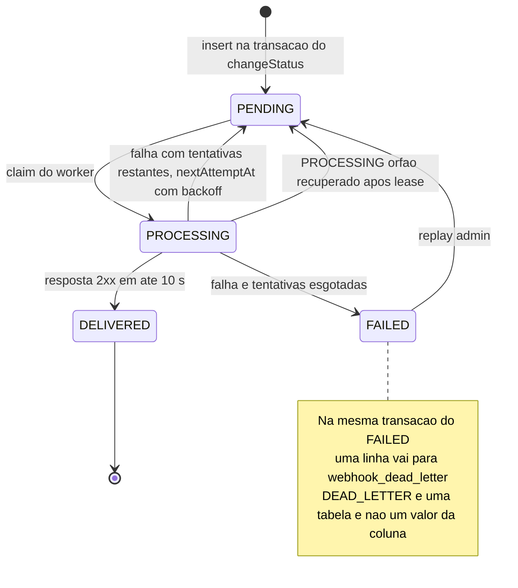
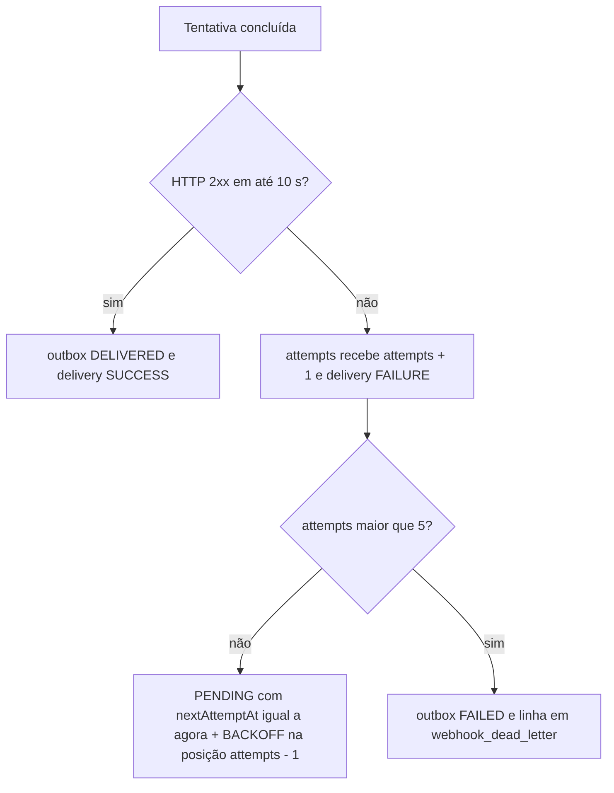

# FDD: Sistema de Webhooks de Notificação de Pedidos

| Campo | Valor |
| --- | --- |
| Versão | 1.0 |
| Data | 2026-10-11 |
| Responsável | Larissa (Tech Lead) |
| Revisores técnicos | Bruno, Diego (sessão de revisão marcada em [09:50 Larissa]); Sofia (revisão de segurança, ver FDD-RISK-07) |
| Documentos relacionados | [RFC](RFC.md), [PRD](PRD.md), [Tracker](TRACKER.md), ADRs: [ADR-001](adrs/ADR-001-outbox-no-mysql.md), [ADR-002](adrs/ADR-002-worker-separado-em-polling.md), [ADR-003](adrs/ADR-003-retry-backoff-exponencial-e-dlq.md), [ADR-004](adrs/ADR-004-hmac-sha256-secret-por-endpoint.md), [ADR-005](adrs/ADR-005-entrega-at-least-once-com-x-event-id.md), [ADR-006](adrs/ADR-006-reuso-dos-padroes-do-projeto.md), [ADR-007](adrs/ADR-007-publicacao-do-evento-na-transacao-do-change-status.md), [ADR-008](adrs/ADR-008-payload-snapshot-na-insercao-da-outbox.md) |

## Como ler este documento

Este FDD responde "como construir, em detalhe". O "por quê" de negócio está no PRD, a proposta e as alternativas estão no RFC, e cada decisão fechada está em um ADR. Aqui só aparece o suficiente de contexto para o desenho fazer sentido.

Convenções usadas:

- Todo item identificável tem um ID em negrito (`FDD-FLX-01`, `FDD-DATA-01`, ...) e, ao lado, a origem entre colchetes (`[09:17 Larissa]`, timestamp e nome em `TRANSCRICAO.md`) ou entre parênteses (caminho de arquivo do código).
- **Hipótese (FDD)** marca qualquer detalhe que NÃO veio da reunião nem do código e foi proposto aqui para fechar o desenho. Hipóteses não são decisões: precisam ser confirmadas na revisão (ver seção 14).
- Arquivos marcados "(novo)" não existem hoje. Todos os demais caminhos citados existem no repositório.
- Os caminhos HTTP aparecem como na reunião (sem prefixo). No código a API é montada sob `/api/v1` (`src/app.ts`), então o caminho real é, por exemplo, `/api/v1/webhooks`. A montagem exata é **Hipótese (FDD)**, derivada do padrão existente.
- Os rótulos locais `OT-NN` (seção 2) e `Q-NN` (seção 14) organizam este documento e não fazem parte do conjunto de IDs rastreados por prefixo.

---

## 1. Contexto e motivação técnica

Três clientes B2B (Atlas Comercial, MaxDistribuição e Nova Cargo) hoje consultam `GET /orders` em loop para descobrir mudança de status; querem ser avisados em menos de 10 segundos e só no sentido plataforma -> cliente [09:00 Marcos] [09:02 Marcos] [09:03 Sofia]. A motivação de negócio está no PRD; abaixo está o que torna o problema técnico não trivial neste código.

- A mudança de status é uma transação já pesada: `OrderService.changeStatus` abre `this.prisma.$transaction`, lê o pedido com itens, valida a transição, debita ou repõe estoque, atualiza `orders`, insere em `order_status_history` e relê o pedido (`src/modules/orders/order.service.ts`, linhas 126 a 179) [09:04 Bruno].
- Chamar HTTP de cliente dentro dessa transação travaria a mudança de status de outros pedidos, e um cliente fora do ar não pode causar rollback do status [09:04 Bruno] [09:06 Diego]. Por isso a decisão é o padrão outbox no MySQL existente ([ADR-001](adrs/ADR-001-outbox-no-mysql.md)), com um worker em processo separado ([ADR-002](adrs/ADR-002-worker-separado-em-polling.md)).
- O sistema não tem hoje nenhum mecanismo de eventos, fila ou notificação externa: `package.json` não lista cliente HTTP, biblioteca de métricas nem de tracing (`package.json`).
- A máquina de estados do pedido (`src/modules/orders/order.status.ts`) define exatamente quais pares `from -> to` existem: PENDING->PAID, PENDING->CANCELLED, PAID->PROCESSING, PAID->CANCELLED, PROCESSING->SHIPPED, PROCESSING->CANCELLED e SHIPPED->DELIVERED. DELIVERED e CANCELLED são terminais. Portanto o `to_status` de um evento nunca é PENDING (nenhuma transição leva a PENDING). Isso delimita a lista de status que um webhook pode escolher ouvir (ver FDD-CONTRATO-01).
- O módulo precisa parecer com os outros: controller, service, repository, routes e schemas, `AppError`, Pino e error middleware centralizado ([ADR-006](adrs/ADR-006-reuso-dos-padroes-do-projeto.md)) [09:27 Bruno] [09:30 Larissa].

Prazo estimado: 3 sprints incluindo pelo menos 2 dias úteis de revisão de segurança da Sofia no fim [09:46 Larissa] [09:46 Sofia] [09:47 Larissa].

---

## 2. Objetivos técnicos

Cada objetivo tem uma medida ou invariante verificável; os critérios de aceite (seção 12) os transformam em testes.

| Rótulo | Objetivo técnico | Medida ou invariante | Origem |
| --- | --- | --- | --- |
| OT-01 | Atomicidade entre mudança de status e registro do evento | Invariante: para todo commit de `changeStatus` existe 1 linha em `webhook_outbox` por webhook ativo do customer que ouve o `to_status`; se o insert falhar, a transação inteira dá rollback (status, history e estoque inalterados) | [09:40 Bruno] [09:41 Diego] |
| OT-02 | Latência ponta a ponta "tempo real" | Medida: do commit até o primeiro POST ao cliente em menos de 10 s com endpoint saudável; polling de 2 s (pior caso de espera ~2 s) | [09:02 Marcos] [09:09 Diego] [09:10 Larissa] |
| OT-03 | Isolar a API de clientes lentos ou fora do ar | Invariante: nenhuma chamada HTTP de saída dentro de `$transaction` nem dentro do processo da API; worker é outro processo (`src/worker.ts`) | [09:04 Bruno] [09:11 Diego] [09:11 Larissa] |
| OT-04 | Entrega at-least-once com deduplicação pelo cliente | Invariante: todo evento tem `event_id` UUID único, enviado em `X-Event-Id` (a igualdade com o `event_id` do corpo é **Hipótese (FDD)**, Q-19), estável em retries e replay | [09:24 Diego] [09:25 Diego] [09:26 Larissa] |
| OT-05 | Retry limitado e fallback persistente | Medida: backoff 1m/5m/30m/2h/12h (5 intervalos; 1 entrega original + 5 re-tentativas é **Hipótese (FDD)**, ver Q-01), depois linha em `webhook_dead_letter`; nunca retry indefinido | [09:15 Diego] [09:17 Larissa] [09:48 Larissa] [09:18 Diego] |
| OT-06 | Autenticidade e integridade da requisição | Medida: HMAC-SHA256 sobre o corpo, secret única por endpoint, rotação com grace de 24 h | [09:20 Sofia] [09:21 Sofia] [09:22 Sofia] |
| OT-07 | Limites de entrada e de tamanho | Medida: URL `https` (senão 400 de validação); payload de no máximo 64KB (65536 bytes), erro e nunca truncamento | [09:23 Sofia] [09:24 Larissa] |
| OT-08 | Reuso máximo do projeto | Medida: nenhuma dependência de runtime nova (**Hipótese (FDD)**: `fetch` e `node:crypto` nativos do Node 20), zero mudança em `error.middleware.ts` | [09:29 Bruno] [09:30 Larissa] |
| OT-09 | Operabilidade mínima | Medida: logs estruturados Pino com `eventId`, `webhookId`, `orderId` e sem secret; sinais mínimos de saúde do worker (seção 9) | [09:29 Bruno]; métricas e tracing: **Hipótese (FDD)** |

---

## 3. Escopo e exclusões

### 3.1 Incluído

- Tabela outbox, DLQ, configuração de webhook e histórico de entregas, com migration Prisma (seção 5).
- `publishWebhookEvent(tx, order, fromStatus, toStatus)` chamada dentro da transação de `changeStatus`, com filtro de eventos na inserção (FDD-FLX-01, FDD-FLX-02).
- Worker em processo separado (`src/worker.ts` + `npm run worker`): polling de 2 s, claim, assinatura, POST com timeout de 10 s, retry com backoff, DLQ (FDD-FLX-03 a FDD-FLX-07).
- CRUD de configuração (`POST`, `GET`, `PATCH`, `DELETE`), histórico de entregas, rotação de secret e replay administrativo da DLQ (seção 6).
- Erros `WEBHOOK_*` reaproveitando `AppError` e subclasses (seção 7).
- Reuso de Pino, error middleware, `authenticate`, `requireRole`, `validate` e esquema de módulos (seção 11).

### 3.2 Excluído (não vira requisito neste FDD)

| Excluído | Origem |
| --- | --- |
| Email ou notificação ao cliente quando o webhook falha (ex: 3 falhas seguidas): fora desta fase | [09:37 Larissa] [09:38 Marcos] |
| Rate limiting de saída por cliente: fora, "observar e decidir depois" (ponto em aberto) | [09:38 Diego] [09:39 Larissa] |
| Dashboard visual ou painel do cliente: só endpoints; projeto separado do time de frontend | [09:39 Marcos] [09:40 Larissa] |
| Webhooks de entrada (inbound) | [09:02 Marcos] [09:03 Sofia] |
| Arquivamento de linhas entregues após ~30 dias: fora do escopo da feature | [09:08 Diego] |
| Ordering global e múltiplos workers (particionar por `order_id` ou lock pessimista): problema do futuro, limitação conhecida | [09:12 Diego] [09:13 Diego] [09:13 Larissa] |
| Exactly-once | [09:25 Diego] |
| Retry indefinido; 3 tentativas | [09:15 Diego] [09:16 Diego] |
| Redis Streams ou fila externa; trigger/NOTIFY do banco; HTTP síncrono no `changeStatus`; id auto incremental na outbox | [09:07 Diego] [09:09 Diego] [09:04 Bruno] [09:51 Larissa] |
| Truncar payload grande | [09:23 Sofia] [09:24 Larissa] |
| Itens (`items`) no payload | [09:43 Diego] |
| Endurecer permissões do CRUD além de autenticação | [09:37 Sofia] |

Fora do escopo por não ter sido tratado na reunião, e não proposto aqui: evento na criação do pedido (`create` não passa por `changeStatus`), ver Q-05.

---

## 4. Fluxos detalhados e diagramas

### 4.1 Diagrama de sequência do fluxo principal



### 4.2 Máquina de estados do evento da outbox

Os quatro estados vêm de [09:08 Diego] ("pendente, processando, falhou, entregue"). `DEAD_LETTER` não é um estado da coluna: é a presença de uma linha em `webhook_dead_letter` ([09:17 Diego] [09:18 Diego]). A linha FAILED permanece na outbox como espelho e a `webhook_dead_letter` é a fonte de evidência e de replay (FDD-FLX-07); o replay reabre a mesma linha FAILED para PENDING (**Hipótese (FDD)**).



### 4.3 Decisão de retry e DLQ



### 4.4 Fluxos

#### (a) Criação do evento na outbox dentro da transação do `changeStatus`

**FDD-FLX-01** Publicação transacional do evento [09:40 Bruno] [09:41 Diego] [09:06 Diego] (`src/modules/orders/order.service.ts`).

1. `OrderService.changeStatus` continua exatamente como hoje até `tx.orderStatusHistory.create(...)` (linhas 159 a 167).
2. Imediatamente depois, e ainda dentro do callback de `this.prisma.$transaction`, passa a chamar `await publishWebhookEvent(tx, order, from, to)`. O `tx` é o mesmo `Prisma.TransactionClient` já usado (tipo `TxClient` declarado na linha 24) [09:41 Bruno].
3. O `order` passado é o registro lido no início da transação (`tx.order.findUnique({ include: { items: true } })`); ele ainda tem o status antigo, por isso o destino vem do parâmetro `toStatus`, nunca de `order.status`.
4. `publishWebhookEvent` executa o filtro (FDD-FLX-02), monta um payload snapshot por webhook (FDD-CONTRATO-09), valida o tamanho e faz `createMany` em `webhook_outbox` com `status = PENDING`.
5. Se qualquer passo lançar exceção (banco indisponível, payload acima do limite, erro de constraint), a exceção propaga para fora do callback e o Prisma dá rollback de tudo: nenhum status muda e nenhum evento é gravado [09:40 Bruno]. O error middleware existente trata o erro (AppError) ou responde 500.
6. Commit: o evento existe e será visto pelo worker. Rollback: o evento some junto [09:06 Diego].
7. O `refreshed` retornado ao controller e o contrato HTTP de `PATCH /orders/:id/status` não mudam (FDD-DEP-09).

Pseudocódigo do ponto de integração (não é código de produção):

```ts
// order.service.ts, dentro de this.prisma.$transaction(async (tx) => { ... })
await tx.order.update({ where: { id }, data: { status: to } });
await tx.orderStatusHistory.create({ data: { /* inalterado */ } });
await publishWebhookEvent(tx, order, from, to);   // NOVO (ADR-007)
const refreshed = await tx.order.findUnique({ /* inalterado */ });
```

O `OrderService` não ganha dependência nova no construtor: `publishWebhookEvent` é uma função que recebe o `tx` ([09:41 Diego]: "Boa, função pura recebendo o tx. Não precisa injetar repository inteiro."). Detalhes em [ADR-007](adrs/ADR-007-publicacao-do-evento-na-transacao-do-change-status.md).

**FDD-FLX-02** Filtro de eventos na inserção (item (f)) [09:33 Marcos] [09:34 Bruno] [09:34 Diego].

1. `tx.webhook.findMany({ where: { customerId: order.customerId, active: true, deletedAt: null } })` (nomes de campos: **Hipótese (FDD)**, ver seção 5).
2. Em memória, mantém só os webhooks cuja lista `events` contém `toStatus`. O filtro é em memória porque `events` é uma coluna JSON (**Hipótese (FDD)**).
3. Se a lista resultante estiver vazia, retorna sem inserir nada: "se nenhum webhook do customer quer aquele status, nem insere" [09:34 Bruno]. Isso economiza linhas na outbox.
4. Se houver 1 ou mais, insere uma linha por webhook, cada uma com seu próprio `event_id` (**Hipótese (FDD)**: o evento é por par pedido/webhook porque a assinatura, a URL e o histórico são por webhook; Diego só disse "único por evento" [09:25]; ver Q-04).
5. O filtro NÃO é reavaliado no momento do envio [09:34 Diego]. Se o webhook for editado depois, eventos já na outbox seguem seu curso (ver FDD-FLX-03 passo 4 para webhook removido ou desativado).

#### (b) Processamento pelo worker

**FDD-FLX-03** Loop de polling e claim [09:09 Diego] [09:10 Larissa] [09:11 Diego] [09:08 Diego] (`src/server.ts` como modelo).

1. `src/worker.ts` (novo) é a entry-point: importa `prisma` de `src/config/database.ts` (uma instância por processo, [09:30 Bruno]) e `logger`, instancia `WebhookWorker` e chama `start()`. Registra SIGINT/SIGTERM como `src/server.ts` faz.
2. O loop usa `setTimeout` recursivo (e não `setInterval`) para nunca sobrepor ticks: após o fim de cada tick, espera 2000 ms e roda de novo (**Hipótese (FDD)** para a forma; o intervalo de 2 s é decisão [09:10 Larissa]).
3. Cada tick lê um batch pequeno de eventos devidos: `status = PENDING AND nextAttemptAt <= now`, `ORDER BY createdAt ASC`, `LIMIT N`. O tamanho "pequeno" do batch não foi fixado na reunião; **Hipótese (FDD)**: N = 10.
4. Claim: para cada candidato, imediatamente antes de despachá-lo (o claim não é feito para o batch inteiro de uma vez, para que um evento não fique em PROCESSING esperando a vez), executa `updateMany({ where: { id, status: PENDING }, data: { status: PROCESSING, processingStartedAt: now } })` e só processa se `count === 1`. A guarda `status = PENDING` impede dupla captura mesmo se, por engano, houver 2 instâncias (FDD-RES-08). Alternativa `SELECT ... FOR UPDATE SKIP LOCKED` fica descartada nesta fase: é a "lock pessimista" que a reunião deixou para o futuro [09:13 Diego].
5. Para cada evento reivindicado, carrega o webhook (url, secret, previous, ativo). Se o webhook estiver removido (`deletedAt`) ou inativo, o evento é encerrado como `FAILED` com `lastError = WEBHOOK_INACTIVE`, sem DLQ e sem POST (**Hipótese (FDD)**: desativar ou remover é decisão do cliente, não falha de entrega; ver Q-06).
6. Concorrência dentro do batch: o DEFAULT é SEQUENCIAL (concorrência 1): o worker processa os eventos do batch um a um, em ordem de `createdAt`, como dito em [09:12 Diego] ("um único worker rodando, ele processa em ordem de created_at do outbox"). Despachar eventos de pedidos diferentes em paralelo (`Promise.allSettled`, com eventos do mesmo `orderId` ainda em sequência) é **Hipótese (FDD)** que se afasta desse "worker sequencial por created_at": fica como opção configurável (`WEBHOOK_CONCURRENCY`, default 1), a decidir na revisão (Q-17). Custo do default sequencial: um cliente lento (até 10 s por chamada) pode atrasar os demais eventos do batch e pressionar o requisito de menos de 10 s (FDD-RISK-09).

**FDD-FLX-04** Montagem do request, assinatura e POST com timeout [09:42 Diego] [09:44 Diego] [09:44 Sofia] [09:20 Sofia].

1. `body = JSON.stringify(outbox.payload)` é calculado UMA vez; os mesmos bytes são assinados e enviados.
2. Valida `Buffer.byteLength(body) <= 65536`. Acima disso o evento falha de forma permanente com `WEBHOOK_PAYLOAD_TOO_LARGE` (guarda de segurança; o ponto de decisão principal é a inserção, FDD-FLX-01).
3. Assinatura: `HMAC-SHA256(secret, body)` em hexadecimal. Durante o grace de rotação são geradas duas assinaturas (FDD-FLX-09). Formato exato do header: **Hipótese (FDD)** (FDD-CONTRATO-11).
4. `fetch(url, { method: 'POST', headers, body, signal: AbortSignal.timeout(10_000), redirect: 'manual' })` (**Hipótese (FDD)**: `fetch` nativo do Node 20 e não seguir redirects). O timeout de 10 s é decisão [09:42 Diego]: sem resposta em 10 s é falha e vai para retry.
5. Headers e corpo seguem o contrato de saída (FDD-CONTRATO-08 e FDD-CONTRATO-09).
6. A conexão com o banco NÃO fica presa durante o POST: não há `$transaction` aberta ao redor da chamada HTTP (FDD-RES-09).

**FDD-FLX-05** Resultado de sucesso [09:08 Diego] [09:34 Marcos].

1. Resposta com status 2xx (**Hipótese (FDD)**: qualquer 2xx é sucesso) encerra a tentativa.
2. Em uma transação curta: `webhook_outbox` -> `DELIVERED` (`deliveredAt`, `attempts + 1`) e `INSERT` em `webhook_deliveries` com `result = SUCCESS`, payload, status e corpo da resposta (truncado, **Hipótese (FDD)**: 4KB) e `durationMs` [09:34 Marcos].
3. Linhas `DELIVERED` permanecem na tabela; o arquivamento é de outra feature [09:08 Diego].

#### (c) Retry com backoff

**FDD-FLX-06** Falha e reagendamento [09:15 Diego] [09:17 Diego] [09:17 Larissa] [09:48 Larissa] [09:42 Diego].

Falha = timeout de 10 s, erro de rede/DNS/TLS, ou resposta que não seja 2xx (**Hipótese (FDD)**: todo não-2xx é tratado igual, inclusive 3xx e 4xx; a reunião só especificou o timeout).

```ts
const BACKOFF_MS = [60_000, 300_000, 1_800_000, 7_200_000, 43_200_000]; // 1m 5m 30m 2h 12h
// após registrar a falha:
attempts += 1;
if (attempts <= BACKOFF_MS.length) {
  status = 'PENDING'; nextAttemptAt = now + BACKOFF_MS[attempts - 1];
} else {
  // FDD-FLX-07
}
```

[09:17 Larissa]: "Decidido: 5 tentativas, backoff 1m/5m/30m/2h/12h" e [09:48 Larissa] resumiu "total 5 tentativas". A reunião não definiu se a 1ª entrega conta nas 5 tentativas. Os 5 intervalos somam 14h36m, compatíveis com "quase 15 horas entre primeira falha e última tentativa" [09:17] Diego, o que só ocorre se a 1ª entrega NÃO conta (1 original + 5 retries). **Hipótese (FDD)** a confirmar com Diego e Larissa (RFC-OPEN-07, Q-01). Sob essa hipótese são 6 tentativas no total e o último retry ocorre 14h36m depois da primeira falha.

| Tentativa | Quando ocorre (a partir da 1ª falha) | Se falhar |
| --- | --- | --- |
| 1 (original) | t0, até ~2 s após o commit | agenda retry 1 em +1 min |
| 2 (retry 1) | +1 min | agenda retry 2 em +5 min |
| 3 (retry 2) | +6 min | agenda retry 3 em +30 min |
| 4 (retry 3) | +36 min | agenda retry 4 em +2 h |
| 5 (retry 4) | +2 h 36 min | agenda retry 5 em +12 h |
| 6 (retry 5) | +14 h 36 min | DLQ (FDD-FLX-07) |

O atraso real de cada retry soma até ~2 s de granularidade de polling ao `nextAttemptAt`. O `event_id` e o corpo (e portanto a assinatura) NÃO mudam entre tentativas; só `X-Timestamp` muda.

#### (d) DLQ e replay admin

**FDD-FLX-07** Esgotamento e envio para a DLQ [09:17 Diego] [09:18 Diego].

Após a 6ª falha (sob a Hipótese (FDD) de Q-01), em uma única transação: `webhook_outbox.status = FAILED` e `INSERT` em `webhook_dead_letter` com payload, motivo da falha e timestamp (`failedAt`), mais `eventId`, `webhookId`, `attempts` e último status HTTP. A linha FAILED fica na outbox como histórico (**Hipótese (FDD)**), fora do índice de leitura do worker (que só lê PENDING), mantendo "leitura da outbox mais limpa" [09:18 Diego]. A linha FAILED permanece na outbox como espelho e a `webhook_dead_letter` é a fonte de evidência e de replay; difere da alternativa "failed na própria outbox" porque a leitura operacional e o replay usam a tabela separada ([09:18] Diego); o replay reabre a mesma linha FAILED para PENDING (**Hipótese (FDD)**).

**FDD-FLX-08** Replay manual por ADMIN [09:18 Diego] [09:35 Diego] [09:36 Sofia] [09:36 Larissa] (`src/middlewares/auth.middleware.ts`).

1. `POST /admin/webhooks/dead-letter/:id/replay` passa por `authenticate` e `requireRole('ADMIN')` (o mesmo padrão de `src/modules/users/user.routes.ts`); OPERATOR recebe 403 `FORBIDDEN` do middleware existente.
2. Transação: busca a linha da DLQ (`WEBHOOK_DEAD_LETTER_NOT_FOUND` se não existir); recusa se já reprocessada (`WEBHOOK_DEAD_LETTER_ALREADY_REPLAYED`, **Hipótese (FDD)**); recusa se o webhook foi removido ou está inativo (`WEBHOOK_INACTIVE`, **Hipótese (FDD)**).
3. "Recoloca na outbox como pendente" [09:18 Diego]: a linha da outbox correspondente volta `FAILED -> PENDING`, `attempts = 0`, `nextAttemptAt = now`, mantendo o MESMO `event_id` (**Hipótese (FDD)**: o cliente continua deduplicando pelo mesmo id, coerente com at-least-once).
4. Marca a linha da DLQ com `replayedAt` e `replayedById` (**Hipótese (FDD)**: colunas extras de auditoria).
5. LOGA quem fez o replay [09:36 Sofia]: `logger.info({ deadLetterId, eventId, webhookId, replayedBy: req.user.id }, 'webhook_dead_letter_replayed')`.
6. Resposta 202 com o resumo (FDD-CONTRATO-07). A entrega acontece depois, no próximo tick do worker.

#### (e) Rotação de secret com grace de 24 h

**FDD-FLX-09** Rotação de secret [09:21 Sofia] [09:22 Sofia] [09:22 Diego] (rota: **Hipótese (FDD)**, ver FDD-CONTRATO-06).

1. `POST /webhooks/:id/rotate-secret` (qualquer role autenticada, como o resto do CRUD [09:36 Marcos] [09:37 Sofia]).
2. Em uma transação: gera nova secret (CSPRNG, FDD-DATA-08), move a secret atual para `secretPrevious`, grava `secretPreviousExpiresAt = now + 24 h` e passa a nova a ser a atual. Uma segunda rotação dentro do grace substitui `secretPrevious` pela secret vigente no momento (a mais antiga deixa de valer; **Hipótese (FDD)**).
3. Devolve a nova secret em claro na resposta, como na criação ("devolvida na criação" [09:31 Marcos]). **Hipótese (FDD)**: só nessa resposta, e nenhum GET devolve secret; a reunião não disse isso explicitamente.
4. No envio, o worker assina com a secret atual e, enquanto `now < secretPreviousExpiresAt`, também com a anterior ("a antiga fica válida por 24 horas em paralelo" [09:21 Sofia]). Como o cliente precisa conseguir validar com qualquer das duas durante a migração, **Hipótese (FDD)**: o header `X-Signature` carrega as duas assinaturas separadas por vírgula (nova primeiro). Passadas as 24 h a antiga "morre": expiração é avaliada no envio (lazy), sem job de limpeza.
5. Loga `webhook_secret_rotated` com `webhookId` e `userId`, nunca a secret.

#### (f) Robustez do worker

**FDD-FLX-10** Recuperação de PROCESSING órfão (**Hipótese (FDD)**, sem origem na reunião).

Se o worker morrer entre o claim e o resultado, a linha ficaria `PROCESSING` para sempre. Proposta: no início de cada tick, `updateMany` devolve para `PENDING` as linhas `PROCESSING` com `processingStartedAt` mais antigo que um lease (sugestão: 60 s, folga sobre o timeout de 10 s). Essa recuperação é a fonte de duplicidade do tipo "POST feito, resultado não gravado", aceita pelo modelo at-least-once (FDD-RES-06).

**FDD-FLX-11** Encerramento gracioso do worker (**Hipótese (FDD)**, espelha `src/server.ts`).

Em SIGINT/SIGTERM: para de agendar novos ticks, aguarda o evento em curso terminar (no máximo ~10 s + gravação, pois não inicia novos eventos do batch), loga `webhook_worker_stopped`, executa `prisma.$disconnect()` e `process.exit(0)`.

---

## 5. Modelo de dados

Mudanças em `prisma/schema.prisma` mais uma migration nova (`npm run db:migrate`, que usa `prisma migrate dev` e depende de `SHADOW_DATABASE_URL`, ver `.env.example`). Padrões seguidos do schema atual: `id String @id @default(uuid()) @db.Char(36)`, `@@map` em snake_case, colunas em camelCase sem `@map` (ex: `customerId`, `createdAt`), `DateTime` com `createdAt/updatedAt`, enums do Prisma (`prisma/schema.prisma`). UUID em todos os ids [09:51 Larissa].

**Hipótese (FDD)** em tudo que segue: a reunião só cita os nomes `webhook_outbox` e `webhook_dead_letter` e, para a configuração, "tabela de configuração de webhook" [09:21 Bruno]. Os nomes `webhooks` e `webhook_deliveries`, os nomes de coluna não citados, tipos, tamanhos e relações abaixo são propostas deste FDD.

**FDD-DATA-01** Tabela `webhooks` (configuração; campos pedidos: url, secret, customer_id, estado ativo [09:21 Bruno]; lista de status [09:33 Marcos]; secret anterior e grace [09:21 Sofia]).

**FDD-DATA-02** Tabela `webhook_outbox` (`id` uuid [09:51 Larissa], payload snapshot [09:52 Larissa], status, índices em status e created_at [09:08 Diego]; coluna `eventId` separada de `id` e igual ao `event_id` do corpo e ao `X-Event-Id`: **Hipótese (FDD)** que responde RFC-OPEN-13, pois Diego só disse "UUID gerado quando o evento entra na outbox" [09:25]; ver Q-19).

**FDD-DATA-03** Tabela `webhook_dead_letter` (payload, motivo da falha, timestamp [09:18 Diego]).

**FDD-DATA-04** Tabela `webhook_deliveries` (histórico para `GET /webhooks/:id/deliveries`: sucesso ou falha, payload, response, tempo de resposta [09:34 Marcos]).

**FDD-DATA-05** Enums novos `WebhookOutboxStatus { PENDING PROCESSING DELIVERED FAILED }` [09:08 Diego] e `WebhookDeliveryResult { SUCCESS FAILURE }` (esse último **Hipótese (FDD)**).

Esboço Prisma (proposta; não é arquivo do repositório):

```prisma
enum WebhookOutboxStatus {
  PENDING
  PROCESSING
  DELIVERED
  FAILED
}

enum WebhookDeliveryResult {
  SUCCESS
  FAILURE
}

model Webhook {
  id                      String    @id @default(uuid()) @db.Char(36)
  customerId              String    @db.Char(36)
  url                     String    @db.VarChar(2048)
  secret                  String    @db.VarChar(255)   // ver FDD-DATA-08 (armazenamento)
  secretPrevious          String?   @db.VarChar(255)
  secretPreviousExpiresAt DateTime?                   // na API: previousSecretExpiresAt (FDD-CONTRATO-12)
  events                  Json                          // ex: ["SHIPPED","DELIVERED"] (valores de OrderStatus)
  active                  Boolean   @default(true)
  deletedAt               DateTime?
  createdAt               DateTime  @default(now())
  updatedAt               DateTime  @updatedAt

  customer    Customer            @relation(fields: [customerId], references: [id], onDelete: Cascade)   // ver FDD-DATA-07 e FDD-DATA-09
  outbox      WebhookOutbox[]
  deadLetters WebhookDeadLetter[]
  deliveries  WebhookDelivery[]

  @@index([customerId, active])
  @@map("webhooks")
}

model WebhookOutbox {
  id                  String              @id @default(uuid()) @db.Char(36)
  eventId             String              @unique @db.Char(36)   // vira X-Event-Id (Hipótese (FDD), Q-19)
  webhookId           String              @db.Char(36)
  orderId             String              @db.Char(36)           // sem FK (ver FDD-DATA-07)
  eventType           String              @default("order.status_changed") @db.VarChar(64)
  payload             Json                                      // snapshot na inserção
  status              WebhookOutboxStatus @default(PENDING)
  attempts            Int                 @default(0)
  nextAttemptAt       DateTime            @default(now())
  processingStartedAt DateTime?
  deliveredAt         DateTime?
  lastError           String?             @db.VarChar(500)
  createdAt           DateTime            @default(now())
  updatedAt           DateTime            @updatedAt

  webhook     Webhook             @relation(fields: [webhookId], references: [id], onDelete: Restrict)
  deadLetters WebhookDeadLetter[]
  deliveries  WebhookDelivery[]

  @@index([status])                    // [09:08] Diego
  @@index([createdAt])                 // [09:08] Diego
  @@index([status, nextAttemptAt])     // Hipótese (FDD): leitura do worker
  @@index([orderId, createdAt])        // Hipótese (FDD): diagnóstico de ordering por pedido
  @@map("webhook_outbox")
}

model WebhookDeadLetter {
  id               String    @id @default(uuid()) @db.Char(36)
  outboxId         String    @db.Char(36)
  eventId          String    @db.Char(36)
  webhookId        String    @db.Char(36)
  payload          Json
  failureCode      String    @db.VarChar(64)     // ex: WEBHOOK_DELIVERY_TIMEOUT
  failureReason    String    @db.VarChar(500)    // motivo da falha [09:18]
  lastResponseStatus Int?
  attempts         Int
  failedAt         DateTime  @default(now())     // timestamp [09:18]
  replayedAt       DateTime?
  replayedById     String?   @db.Char(36)

  outbox     WebhookOutbox @relation(fields: [outboxId], references: [id], onDelete: Restrict)
  webhook    Webhook       @relation(fields: [webhookId], references: [id], onDelete: Restrict)
  replayedBy User?         @relation("WebhookReplayedBy", fields: [replayedById], references: [id])

  @@index([webhookId, failedAt])
  @@index([eventId])
  @@map("webhook_dead_letter")
}

model WebhookDelivery {
  id             String                @id @default(uuid()) @db.Char(36)
  webhookId      String                @db.Char(36)
  outboxId       String                @db.Char(36)
  eventId        String                @db.Char(36)
  attempt        Int
  result         WebhookDeliveryResult
  requestPayload Json
  responseStatus Int?
  responseBody   String?               @db.Text   // truncado (hipótese: 4KB)
  durationMs     Int
  errorCode      String?               @db.VarChar(64)
  errorMessage   String?               @db.VarChar(500)
  createdAt      DateTime              @default(now())

  webhook Webhook       @relation(fields: [webhookId], references: [id], onDelete: Restrict)
  outbox  WebhookOutbox @relation(fields: [outboxId], references: [id], onDelete: Restrict)

  @@index([webhookId, createdAt])
  @@map("webhook_deliveries")
}
```

**FDD-DATA-06** Índices. Os dois índices citados na reunião ([09:08 Diego]: status e created_at) são obrigatórios. Os demais (`[status, nextAttemptAt]`, `[orderId, createdAt]`, `[customerId, active]`, `[webhookId, createdAt]`) são **Hipótese (FDD)** de desempenho: a query do worker filtra por status e `nextAttemptAt`, e o `GET deliveries` ordena por data dentro de um webhook.

**FDD-DATA-07** Sem FK de `webhook_outbox.orderId` para `orders` (**Hipótese (FDD)**). O payload é snapshot e independente do pedido [09:52 Larissa]; além disso `OrderService.delete` permite apagar pedidos CANCELLED (`src/modules/orders/order.service.ts`), o que quebraria por FK ou apagaria evidência por cascade. Regras de `onDelete` (**Hipótese (FDD)**): `Customer -> Webhook` é `Cascade` (só alcança webhooks sem evidência, ver trade-off abaixo); `Webhook -> webhook_outbox, webhook_dead_letter, webhook_deliveries` e `webhook_outbox -> webhook_dead_letter, webhook_deliveries` são `Restrict`, para a evidência (DLQ, histórico de entregas) nunca ser apagada em cascata, coerente com FDD-DATA-09. Trade-off registrado (Q-20): apagar um customer que tenha webhooks com evidência passa a ser bloqueado pelo banco (P2003, que o `error.middleware.ts` não trata e viraria 500) em vez de apagar a evidência; na prática o caso é raro, porque `Order -> Customer` já não tem cascade e customers com pedidos não são apagáveis (o customer só chega a esse ponto se nunca teve pedidos, ou se os pedidos CANCELLED foram apagados depois de gerarem eventos). Se o time preferir que apagar o customer apague também a evidência, basta trocar `Restrict` por `Cascade` nessas relações.

**FDD-DATA-08** Armazenamento da secret (**Hipótese (FDD)**, NÃO decidido na reunião; ver Q-02). O worker precisa da secret em claro para calcular o HMAC, então hash unidirecional não serve. Proposta: gerar com `crypto.randomBytes(32)` (CSPRNG, 64 caracteres hex, com prefixo `whsec_`), devolver em claro uma única vez e guardar cifrada (AES-256-GCM, chave em nova variável de ambiente, formato `iv:tag:ciphertext` em base64). Alternativa: texto puro com acesso restrito. A decisão é da revisão de segurança da Sofia [09:46 Sofia] [09:49 Sofia] (ela quer revisar o código de HMAC e de geração de secret).

**FDD-DATA-09** Soft delete em `webhooks` (**Hipótese (FDD)**): `DELETE /webhooks/:id` seta `deletedAt` e `active = false`, preservando outbox, DLQ e deliveries como evidência (as relações com `onDelete: Restrict` de FDD-DATA-07 impedem que um delete físico apague essa evidência). Consultas normais filtram `deletedAt IS NULL`.

**FDD-DATA-10** Alterações em models existentes limitadas a campos de relação: `Customer.webhooks Webhook[]` e `User.webhookReplays WebhookDeadLetter[] @relation("WebhookReplayedBy")`. Nenhuma coluna de `orders`, `order_items`, `order_status_history` etc. muda (`prisma/schema.prisma`).

**FDD-DATA-11** Retenção e arquivamento de `webhook_outbox`, `webhook_deliveries` e `webhook_dead_letter` estão FORA do escopo [09:08 Diego] e registrados como risco (FDD-RISK-04).

---

## 6. Contratos públicos

**FDD-CONTRATO-12** Convenções gerais da API de configuração.

- Prefixo de montagem `/api/v1` (`src/app.ts`); nos exemplos abaixo o caminho completo é mostrado. A reunião cita os caminhos sem prefixo [09:34 Marcos] [09:35 Diego].
- Autenticação: header `Authorization: Bearer <JWT>` do sistema (`authenticate` em `src/middlewares/auth.middleware.ts`). CRUD, deliveries e rotação: qualquer role autenticada [09:36 Marcos] [09:37 Sofia]. Replay: apenas `ADMIN` [09:36 Sofia] [09:36 Larissa].
- O `customerId` NÃO vem do JWT: vem no body (POST) ou na query (GET) [09:32 Larissa] (query: **Hipótese (FDD)**; a reunião só diz "body ou no path").
- Corpos e respostas JSON em camelCase, como o restante da API (`customerId`, `toStatus` em `src/modules/orders/order.schemas.ts`). **Hipótese (FDD)**. O payload ENVIADO ao cliente usa snake_case, como definido na reunião [09:43 Diego].
- Erros: `{ "error": { "code", "message", "details?" } }` (`src/middlewares/error.middleware.ts`).
- Listagens: `{ "data": [...], "pagination": { page, pageSize, total, totalPages } }` (`src/shared/http/response.ts`).
- `X-Request-Id` é aceito e devolvido pelo `requestLogger` (`src/middlewares/request-logger.middleware.ts`).
- A resposta de um webhook NUNCA inclui `secret` (nem `secretPrevious`), exceto no POST de criação e no de rotação (a secret "devolvida na criação" é de [09:31 Marcos]; "só uma vez" e "nenhum GET devolve" são **Hipótese (FDD)**).
- Nomes: o campo de API `previousSecretExpiresAt` corresponde à coluna `webhooks.secretPreviousExpiresAt` (FDD-DATA-01); a API nunca expõe `secretPrevious`. Cada camada usa uma grafia só: API `previousSecretExpiresAt`, banco `secretPreviousExpiresAt`.

Resumo dos endpoints:

| ID | Método e caminho (completo no código) | Auth | Sucesso | Origem |
| --- | --- | --- | --- | --- |
| **FDD-CONTRATO-01** | `POST /webhooks` (`/api/v1/webhooks`) | JWT, qualquer role | 201 | [09:31 Marcos] [09:32 Larissa] |
| **FDD-CONTRATO-02** | `GET /webhooks?customerId=` | JWT, qualquer role | 200 | [09:33 Bruno]; `customerId` na query: **Hipótese (FDD)** ([09:32 Larissa] só diz body ou path) |
| **FDD-CONTRATO-03** | `PATCH /webhooks/:id` | JWT, qualquer role | 200 | [09:33 Bruno] |
| **FDD-CONTRATO-04** | `DELETE /webhooks/:id` | JWT, qualquer role | 204 | [09:33 Bruno] |
| **FDD-CONTRATO-05** | `GET /webhooks/:id/deliveries` | JWT, qualquer role | 200 | [09:34 Marcos] |
| **FDD-CONTRATO-06** | `POST /webhooks/:id/rotate-secret` (**Hipótese (FDD)**) | JWT, qualquer role | 200 | [09:21 Sofia] (rota proposta) |
| **FDD-CONTRATO-07** | `POST /admin/webhooks/dead-letter/:id/replay` | JWT, `ADMIN` | 202 | [09:18 Diego] [09:35 Diego] [09:36 Sofia] |

### **FDD-CONTRATO-01** `POST /webhooks`

Cadastra um webhook. A secret é gerada pela plataforma e devolvida na criação [09:31 Marcos]; que seja devolvida só nesta resposta é **Hipótese (FDD)**.

Request:

```http
POST /api/v1/webhooks
Authorization: Bearer <jwt>
Content-Type: application/json
```

```json
{
  "customerId": "3f2b8c1e-5d4a-4c7e-9a10-1b2c3d4e5f60",
  "url": "https://erp.atlascomercial.example/hooks/oms",
  "events": ["SHIPPED", "DELIVERED"]
}
```

Validação Zod (`webhook.schemas.ts`, novo): `customerId` uuid; `url` string com `new URL` válida e protocolo `https:` obrigatório [09:23 Sofia]; **Hipótese (FDD)**: máximo de 2048 caracteres na `url` (alinhado a `VarChar(2048)`); `events` array de `z.nativeEnum(OrderStatus)` [09:33 Marcos], e **Hipótese (FDD)**: sem repetição, com ao menos 1 item e sem o valor `PENDING` porque nenhuma transição leva a PENDING (`src/modules/orders/order.status.ts`).

Response `201 Created`:

```json
{
  "id": "b7e1a2d4-0c93-4f6b-8a55-2e9d71c4f3aa",
  "customerId": "3f2b8c1e-5d4a-4c7e-9a10-1b2c3d4e5f60",
  "url": "https://erp.atlascomercial.example/hooks/oms",
  "events": ["SHIPPED", "DELIVERED"],
  "active": true,
  "secret": "whsec_9f1c0b7a4e2d4c8aa1b3c5d7e9f102132435465768798a9bacbdcedfe0f1a2b3",
  "previousSecretExpiresAt": null,
  "createdAt": "2026-10-12T13:00:00.000Z",
  "updatedAt": "2026-10-12T13:00:00.000Z"
}
```

Status codes: 201; 400 `VALIDATION_ERROR` (inclui `http://`); 401 `UNAUTHORIZED`; 404 `NOT_FOUND` ("Customer not found", `NotFoundError('Customer')`, igual ao padrão de `order.service.ts`); 500 `INTERNAL_SERVER_ERROR`.

Exemplo de erro (URL http):

```json
{
  "error": {
    "code": "VALIDATION_ERROR",
    "message": "Validation failed",
    "details": [{ "path": "url", "message": "Webhook URL must use https" }]
  }
}
```

Semântica: o formato do código de erro para URL inválida (VALIDATION_ERROR vs `WEBHOOK_INVALID_URL`) está em aberto, ver FDD-ERR-02 e Q-03. A secret NÃO ser recuperável depois é **Hipótese (FDD)**; para obter outra, usar FDD-CONTRATO-06. `WEBHOOK_SECRET_REQUIRED` NÃO é erro de cadastro: a secret é gerada pela plataforma e o cliente não a envia (ver FDD-ERR-03).

### **FDD-CONTRATO-02** `GET /webhooks?customerId=`

Lista os webhooks de um customer [09:33 Bruno] (query: **Hipótese (FDD)**; a reunião só diz body ou path para o `customerId` [09:32 Larissa]).

```http
GET /api/v1/webhooks?customerId=3f2b8c1e-5d4a-4c7e-9a10-1b2c3d4e5f60&page=1&pageSize=20
Authorization: Bearer <jwt>
```

Query: `customerId` obrigatório (uuid; na query: **Hipótese (FDD)**); `page` (default 1) e `pageSize` (default 20, máx. 100), seguindo `listOrdersQuerySchema` e `paginated` (**Hipótese (FDD)**: paginação).

Response `200 OK`:

```json
{
  "data": [
    {
      "id": "b7e1a2d4-0c93-4f6b-8a55-2e9d71c4f3aa",
      "customerId": "3f2b8c1e-5d4a-4c7e-9a10-1b2c3d4e5f60",
      "url": "https://erp.atlascomercial.example/hooks/oms",
      "events": ["SHIPPED", "DELIVERED"],
      "active": true,
      "previousSecretExpiresAt": null,
      "createdAt": "2026-10-12T13:00:00.000Z",
      "updatedAt": "2026-10-12T13:00:00.000Z"
    }
  ],
  "pagination": { "page": 1, "pageSize": 20, "total": 1, "totalPages": 1 }
}
```

Status codes: 200; 400 `VALIDATION_ERROR` (sem `customerId`, uuid inválido); 401. Webhooks removidos (`deletedAt`) não aparecem. Qualquer usuário autenticado pode listar de qualquer customer, consequência direta de o `customerId` não vir do JWT [09:32 Larissa] [09:37 Sofia] (ver FDD-RISK-10). Sem `secret` na resposta.

### **FDD-CONTRATO-03** `PATCH /webhooks/:id`

Edita url, eventos ou estado ativo [09:33 Bruno].

```http
PATCH /api/v1/webhooks/b7e1a2d4-0c93-4f6b-8a55-2e9d71c4f3aa
Authorization: Bearer <jwt>
Content-Type: application/json
```

```json
{ "events": ["PAID", "SHIPPED", "DELIVERED"], "active": true }
```

Campos aceitos (todos opcionais, ao menos 1): `url` (https), `events`, `active`. `customerId` e `secret` NÃO são editáveis por PATCH (**Hipótese (FDD)**; a secret muda só por FDD-CONTRATO-06).

Response `200 OK`:

```json
{
  "id": "b7e1a2d4-0c93-4f6b-8a55-2e9d71c4f3aa",
  "customerId": "3f2b8c1e-5d4a-4c7e-9a10-1b2c3d4e5f60",
  "url": "https://erp.atlascomercial.example/hooks/oms",
  "events": ["PAID", "SHIPPED", "DELIVERED"],
  "active": true,
  "previousSecretExpiresAt": null,
  "createdAt": "2026-10-12T13:00:00.000Z",
  "updatedAt": "2026-10-12T13:20:00.000Z"
}
```

Status codes: 200; 400 `VALIDATION_ERROR` (http, body vazio, enum inválido); 401; 404 `WEBHOOK_NOT_FOUND`. Semântica: a mudança vale para eventos inseridos a partir de então; eventos já na outbox não são refiltrados [09:34 Diego].

### **FDD-CONTRATO-04** `DELETE /webhooks/:id`

Remove o webhook [09:33 Bruno]. **Hipótese (FDD)**: remoção lógica (FDD-DATA-09).

```http
DELETE /api/v1/webhooks/b7e1a2d4-0c93-4f6b-8a55-2e9d71c4f3aa
Authorization: Bearer <jwt>
```

Response: `204 No Content`, sem corpo (mesmo padrão de `customer.controller.ts`). Status codes: 204; 400 (id não uuid); 401; 404 `WEBHOOK_NOT_FOUND` (inclusive em segundo DELETE do mesmo id). Semântica: novos eventos deixam de ser gerados; eventos pendentes na outbox são encerrados pelo worker sem POST (FDD-FLX-03 passo 5).

### **FDD-CONTRATO-05** `GET /webhooks/:id/deliveries`

Histórico dos últimos 100 envios: sucesso ou falha, payload, response, tempo de resposta [09:34 Marcos].

```http
GET /api/v1/webhooks/b7e1a2d4-0c93-4f6b-8a55-2e9d71c4f3aa/deliveries
Authorization: Bearer <jwt>
```

Response `200 OK` (ordenado do mais recente para o mais antigo; no máximo 100 itens; **Hipótese (FDD)**: janela fixa de 100, sem paginação adicional, formato `{data, pagination}` com `pageSize: 100`):

```json
{
  "data": [
    {
      "id": "0d6f8e9a-1b2c-4d3e-8f40-5a6b7c8d9e01",
      "eventId": "7c9e6679-7425-40de-944b-e07fc1f90ae7",
      "attempt": 2,
      "result": "SUCCESS",
      "requestPayload": {
        "event_id": "7c9e6679-7425-40de-944b-e07fc1f90ae7",
        "event_type": "order.status_changed",
        "timestamp": "2026-10-12T14:03:21.482Z",
        "order_id": "0a1b2c3d-4e5f-4a6b-8c7d-9e0f1a2b3c4d",
        "order_number": "ORD-000123",
        "from_status": "PROCESSING",
        "to_status": "SHIPPED",
        "customer_id": "3f2b8c1e-5d4a-4c7e-9a10-1b2c3d4e5f60",
        "total_cents": 16500
      },
      "responseStatus": 200,
      "responseBody": "{\"ok\":true}",
      "durationMs": 184,
      "errorCode": null,
      "createdAt": "2026-10-12T14:04:33.700Z"
    },
    {
      "id": "6a5b4c3d-2e1f-4a0b-9c8d-7e6f5a4b3c2d",
      "eventId": "7c9e6679-7425-40de-944b-e07fc1f90ae7",
      "attempt": 1,
      "result": "FAILURE",
      "requestPayload": { "event_id": "7c9e6679-7425-40de-944b-e07fc1f90ae7", "event_type": "order.status_changed" },
      "responseStatus": null,
      "responseBody": null,
      "durationMs": 10001,
      "errorCode": "WEBHOOK_DELIVERY_TIMEOUT",
      "createdAt": "2026-10-12T14:03:33.512Z"
    }
  ],
  "pagination": { "page": 1, "pageSize": 100, "total": 2, "totalPages": 1 }
}
```

(Em produção `requestPayload` contém o payload completo também nas falhas; encurtado aqui só por brevidade. Linha de tempo do exemplo: payload gerado em 14:03:21.482Z; a tentativa 1 envia por volta de 14:03:23.500Z (X-Timestamp de FDD-CONTRATO-08), expira após 10 s e é gravada em 14:03:33.512Z; o retry 1 vence 1 min depois, por volta de 14:04:33.500Z, e a tentativa 2 é gravada em 14:04:33.700Z. `createdAt` é o instante da gravação da linha.)

Status codes: 200; 400 (id não uuid); 401; 404 `WEBHOOK_NOT_FOUND`. A tabela guarda uma linha por TENTATIVA, então um mesmo `eventId` pode aparecer várias vezes (`attempt` 1..6).

### **FDD-CONTRATO-06** `POST /webhooks/:id/rotate-secret` (rota: Hipótese (FDD))

A reunião define a capacidade ("endpoint pro cliente conseguir pedir nova secret pela API" [09:21 Sofia]) mas NÃO a rota. A rota é proposta deste FDD, em estilo de ação como `PATCH /orders/:id/status`.

```http
POST /api/v1/webhooks/b7e1a2d4-0c93-4f6b-8a55-2e9d71c4f3aa/rotate-secret
Authorization: Bearer <jwt>
```

Sem corpo. Response `200 OK`:

```json
{
  "id": "b7e1a2d4-0c93-4f6b-8a55-2e9d71c4f3aa",
  "secret": "whsec_3a4b5c6d7e8f9012a3b4c5d6e7f8091a2b3c4d5e6f708192a3b4c5d6e7f80910",
  "previousSecretExpiresAt": "2026-10-13T13:30:00.000Z"
}
```

Status codes: 200; 400; 401; 404 `WEBHOOK_NOT_FOUND`; 409 `WEBHOOK_INACTIVE` (**Hipótese (FDD)**, webhook inativo não rotaciona; ver Q-06). Semântica: ver FDD-FLX-09; durante 24 h o envio leva as duas assinaturas.

### **FDD-CONTRATO-07** `POST /admin/webhooks/dead-letter/:id/replay`

Reprocessamento manual de um evento da DLQ [09:18 Diego] [09:35 Diego]. Exige role `ADMIN` e registra quem executou [09:36 Sofia] [09:36 Larissa].

```http
POST /api/v1/admin/webhooks/dead-letter/5e4d3c2b-1a09-4f8e-b7d6-c5b4a3928170/replay
Authorization: Bearer <jwt de ADMIN>
```

Sem corpo. Response `202 Accepted` (**Hipótese (FDD)**: 202 porque a entrega ocorre depois, no worker):

```json
{
  "deadLetterId": "5e4d3c2b-1a09-4f8e-b7d6-c5b4a3928170",
  "outboxId": "9b8a7c6d-5e4f-4a3b-8c2d-1e0f9a8b7c6d",
  "eventId": "7c9e6679-7425-40de-944b-e07fc1f90ae7",
  "webhookId": "b7e1a2d4-0c93-4f6b-8a55-2e9d71c4f3aa",
  "status": "PENDING",
  "replayedAt": "2026-10-12T20:00:00.000Z",
  "replayedById": "c1d2e3f4-a5b6-4c7d-8e9f-0a1b2c3d4e5f"
}
```

Status codes: 202; 400 (id não uuid); 401 `UNAUTHORIZED`; 403 `FORBIDDEN` (role OPERATOR, via `requireRole('ADMIN')`); 404 `WEBHOOK_DEAD_LETTER_NOT_FOUND`; 409 `WEBHOOK_DEAD_LETTER_ALREADY_REPLAYED` ou `WEBHOOK_INACTIVE`. Efeito colateral obrigatório: log `webhook_dead_letter_replayed` com `replayedBy` (id do usuário ADMIN) [09:36 Sofia]. O `event_id` é preservado; o cliente deduplica como em qualquer outra reentrega.

### Contrato de saída: o que o worker envia ao cliente

**FDD-CONTRATO-08** Request de saída (headers) [09:44 Diego] [09:44 Sofia] [09:45 Diego].

```http
POST https://erp.atlascomercial.example/hooks/oms
Content-Type: application/json
X-Event-Id: 7c9e6679-7425-40de-944b-e07fc1f90ae7
X-Webhook-Id: b7e1a2d4-0c93-4f6b-8a55-2e9d71c4f3aa
X-Timestamp: 2026-10-12T14:03:23.500Z
X-Signature: sha256=5d41402abc4b2a76b9719d911017c592a1b2c3d4e5f60718293a4b5c6d7e8f90
```

| Header | Valor | Origem |
| --- | --- | --- |
| `Content-Type` | `application/json` | [09:44 Diego] |
| `X-Event-Id` | UUID do evento, gerado quando a linha entra na outbox e único por evento [09:25 Diego]. Que seja igual ao `event_id` do corpo e à coluna `eventId` (separada de `id`) é **Hipótese (FDD)** que responde RFC-OPEN-13 (Q-19) | [09:25 Diego] (UUID único) |
| `X-Signature` | assinatura HMAC-SHA256 do corpo (formato em FDD-CONTRATO-11) | [09:20 Sofia] [09:44 Diego] |
| `X-Timestamp` | timestamp do envio (para o cliente detectar replay attack se quiser). Formato: **Hipótese (FDD)** ISO 8601 UTC, coerente com o `timestamp` do payload | [09:44 Diego] |
| `X-Webhook-Id` | id do endpoint webhook cadastrado (`webhooks.id`), para clientes com vários cadastros | [09:44 Sofia] [09:45 Diego] |

`X-Timestamp` muda a cada tentativa; `X-Event-Id` e o corpo não mudam.

**FDD-CONTRATO-09** Corpo `order.status_changed` [09:43 Diego] [09:44 Bruno] [09:52 Larissa].

```json
{
  "event_id": "7c9e6679-7425-40de-944b-e07fc1f90ae7",
  "event_type": "order.status_changed",
  "timestamp": "2026-10-12T14:03:21.482Z",
  "order_id": "0a1b2c3d-4e5f-4a6b-8c7d-9e0f1a2b3c4d",
  "order_number": "ORD-000123",
  "from_status": "PROCESSING",
  "to_status": "SHIPPED",
  "customer_id": "3f2b8c1e-5d4a-4c7e-9a10-1b2c3d4e5f60",
  "total_cents": 16500
}
```

Regras: os campos de [09:43 Diego] são `event_id`, `event_type`, `timestamp`, `order_id`, `order_number`, `from_status`, `to_status`, `customer_id` "e os campos básicos da order tipo total_cents"; a lista exata acima (`order_number` e `total_cents` e nada além) é **Hipótese (FDD)**, como no ADR-008; NÃO inclui `items`, o cliente consulta `GET /orders/:id` se quiser detalhes [09:43 Diego]; é um SNAPSHOT montado na inserção da outbox, não renderizado no envio [09:52 Larissa] [09:52 Diego]; `timestamp` é o instante da mudança de status (momento da inserção), não do envio; tamanho máximo de 64KB (65536 bytes do JSON serializado) com erro e nunca truncamento [09:24 Larissa]. `order_number` vem de `Order.orderNumber`, `total_cents` de `Order.totalCents` (`prisma/schema.prisma`). Como o MySQL normaliza JSON (ordem das chaves), o cliente DEVE validar a assinatura sobre os bytes brutos recebidos, nunca sobre um JSON reserializado.

**FDD-CONTRATO-10** Assinatura da função de publicação [09:41 Bruno] [09:41 Diego].

```ts
// src/modules/webhooks/webhook.publisher.ts (novo; nome do arquivo: Hipótese (FDD))
import type { Order, OrderStatus, Prisma } from '@prisma/client';

export async function publishWebhookEvent(
  tx: Prisma.TransactionClient,
  order: Pick<Order, 'id' | 'orderNumber' | 'customerId' | 'totalCents'>,
  fromStatus: OrderStatus,
  toStatus: OrderStatus,
): Promise<void>;
```

Os quatro parâmetros e a ordem são os da reunião. O tipo estreito de `order` (`Pick<...>`) e o retorno `Promise<void>` são **Hipótese (FDD)**; o `order` real de `changeStatus` (retorno de `tx.order.findUnique({ include: { items: true } })`) é compatível. Contrato: lança exceção em qualquer falha (para forçar rollback); não faz I/O fora do `tx`; não faz HTTP.

**FDD-CONTRATO-11** Formato do `X-Signature` (**Hipótese (FDD)**: a reunião só decidiu "HMAC-SHA256 sobre o corpo do request" [09:22 Sofia] e o nome do header [09:20 Sofia]).

- Valor: `sha256=<hex minúsculo do HMAC-SHA256(secret, corpo bruto)>`.
- O timestamp NÃO entra no material assinado (a reunião diz "sobre o corpo"); `X-Timestamp` é apenas informativo para o cliente.
- Durante o grace de rotação: `sha256=<hex com a secret nova>,sha256=<hex com a secret anterior>`; o cliente aceita se QUALQUER uma bater.
- Cálculo no servidor: `createHmac('sha256', secret).update(body).digest('hex')` (`node:crypto`), e comparação no lado do cliente em tempo constante (recomendação para o portal de desenvolvedor [09:26 Marcos] [09:40 Marcos]).
- Alternativas em aberto: hex puro sem prefixo, ou assinar `timestamp.corpo` (proteção forte contra replay). Q-02.

---

## 7. Matriz de erros previstos

Todos os erros seguem o padrão `AppError(message, statusCode, errorCode, details?)` (`src/shared/errors/app-error.ts`) e as subclasses de `src/shared/errors/http-errors.ts`, com prefixo `WEBHOOK_` [09:28 Bruno] [09:29 Larissa]. Serão classes novas no mesmo arquivo (como `InsufficientStockError` e `InvalidStatusTransitionError`), reexportadas por `src/shared/errors/index.ts`. O `error.middleware.ts` já devolve qualquer `AppError` como `{ error: { code, message, details? } }`, sem mudança [09:29 Bruno].

| ID | Código | HTTP | Classe base reutilizada (`src/shared/errors/http-errors.ts`) | Condição | Tratamento | Origem |
| --- | --- | --- | --- | --- | --- | --- |
| **FDD-ERR-01** | `WEBHOOK_NOT_FOUND` | 404 | `NotFoundError` (ver nota 1) | webhook inexistente ou removido em GET deliveries, PATCH, DELETE, rotate-secret | resposta de erro padrão; nenhum efeito | [09:28 Bruno] |
| **FDD-ERR-02** | `WEBHOOK_INVALID_URL` | 400 | `BadRequestError` (aceita `code` customizado) | URL que não passa na validação de URL do módulo (ver nota 2) | resposta de erro; nada gravado | [09:28 Bruno] [09:23 Sofia] |
| **FDD-ERR-03** | `WEBHOOK_SECRET_REQUIRED` | 422 | `UnprocessableEntityError` | tentativa de assinar ou enviar para webhook sem secret utilizável (ver nota 3) | na API: 422; no worker: falha permanente do evento (`FAILED`) com log `error` | [09:28 Bruno] |
| **FDD-ERR-04** | `WEBHOOK_PAYLOAD_TOO_LARGE` | 422 | `UnprocessableEntityError` | corpo serializado do payload acima de 65536 bytes | na inserção: lança, a transação do `changeStatus` dá rollback (ver nota 4); no worker (guarda): `FAILED` + DLQ com `failureCode` | proposto no FDD; limite em [09:23 Sofia] [09:24 Diego] [09:24 Larissa] |
| **FDD-ERR-05** | `WEBHOOK_DELIVERY_TIMEOUT` | n/a (interno, não trafega em HTTP) | motivo de falha registrado em `webhook_deliveries.errorCode` e `webhook_dead_letter.failureCode`; se virar classe, estende `AppError` | sem resposta do cliente em 10 s (`AbortSignal.timeout`) | conta como falha da tentativa; retry com backoff (FDD-FLX-06) | proposto no FDD; timeout em [09:42 Diego] |
| **FDD-ERR-06** | `WEBHOOK_DELIVERY_FAILED` | n/a (interno) | idem FDD-ERR-05 | resposta não-2xx, erro de rede/DNS/TLS ou redirect (3xx não seguido) | conta como falha da tentativa; retry com backoff; ao esgotar, DLQ | proposto no FDD |
| **FDD-ERR-07** | `WEBHOOK_DEAD_LETTER_NOT_FOUND` | 404 | `NotFoundError` (ver nota 1) | replay de id inexistente na DLQ | resposta de erro padrão | proposto no FDD |
| **FDD-ERR-08** | `WEBHOOK_DEAD_LETTER_ALREADY_REPLAYED` | 409 | `ConflictError` | replay de linha da DLQ que já foi reprocessada (`replayedAt` preenchido) | resposta 409; nada alterado | proposto no FDD |
| **FDD-ERR-09** | `WEBHOOK_INACTIVE` | 409 | `ConflictError` | replay ou rotação para webhook removido ou inativo; também usado como motivo interno quando o worker encontra o webhook inativo ou removido | API: 409; worker: encerra o evento sem POST (FDD-FLX-03 passo 5) | proposto no FDD |
| **FDD-ERR-10** | `FORBIDDEN` (existente) | 403 | `ForbiddenError`, disparado por `requireRole('ADMIN')` | replay por usuário não ADMIN | resposta padrão. NÃO se cria `WEBHOOK_REPLAY_FORBIDDEN`: o middleware existente já cobre e a decisão foi reaproveitar `requireRole` | [09:36 Larissa] (`src/middlewares/auth.middleware.ts`) |
| **FDD-ERR-11** | `VALIDATION_ERROR` (existente) | 400 | `ValidationError` via `validate()` | body, query ou params inválidos (inclui `http://` se validado só no Zod, `customerId` ausente) | resposta padrão com `details` por campo | `src/middlewares/validate.middleware.ts` |
| **FDD-ERR-12** | `NOT_FOUND` (existente) | 404 | `NotFoundError('Customer')` | `customerId` do POST não existe | resposta padrão (mesmo padrão de `OrderService.create`) | `src/modules/orders/order.service.ts` |
| **FDD-ERR-13** | `UNAUTHORIZED` (existente) | 401 | `UnauthorizedError` | ausência ou invalidez do JWT | resposta padrão | `src/middlewares/auth.middleware.ts` |

Notas:

1. `NotFoundError` hoje fixa o código `'NOT_FOUND'` no construtor e só aceita o nome do recurso (`src/shared/errors/http-errors.ts`). Para devolver `WEBHOOK_NOT_FOUND` há duas opções: (a) a classe estende `AppError` diretamente com 404 e o código; (b) `NotFoundError` ganha um segundo parâmetro opcional `code = 'NOT_FOUND'` (mudança retrocompatível no arquivo existente). **Hipótese (FDD)**: preferir (b) para manter a hierarquia; decidir na revisão (Q-07).
2. `validate()` converte erro Zod em `ValidationError`, ou seja, `http://` rejeitado no schema volta como `VALIDATION_ERROR` 400 com `details`, que é o que a reunião descreve ("recusamos com erro de validação" [09:23 Sofia]). O código `WEBHOOK_INVALID_URL` citado por Bruno [09:28] fica então com um papel não definido. **Hipótese (FDD)**: o service revalida a URL (defesa em profundidade, também no PATCH) e lança `WEBHOOK_INVALID_URL` quando algo escapa do schema; o caso comum de `http://` continua `VALIDATION_ERROR`. Q-03.
3. A reunião lista `WEBHOOK_SECRET_REQUIRED` sem condição de uso; como a secret é sempre gerada pela plataforma [09:31 Marcos], o cliente não a envia. **Hipótese (FDD)** de uso: proteger o ponto de assinatura contra webhook sem secret (dado corrompido).
4. Como o payload é fixo e enxuto (~300 bytes, sem `items`), exceder 64KB é praticamente impossível; a falha existe como guarda de requisito não funcional [09:24 Larissa]. Efeito indireto: nesse caso improvável `PATCH /orders/:id/status` responderia 422 `WEBHOOK_PAYLOAD_TOO_LARGE`, coerente com "não pode ter caso de status mudar e evento não sair" [09:40 Bruno]. Que esse caso aborte a mudança de status com 422 e rollback é **Hipótese (FDD)** e a reunião não decidiu esse caso específico (RFC-OPEN-12, Q-18).

---

## 8. Estratégias de resiliência

**FDD-RES-01** Timeout de saída de 10 s por chamada HTTP; sem resposta em 10 s é falha e vai para retry [09:42 Diego]. Implementação sugerida: `AbortSignal.timeout(10_000)` (**Hipótese (FDD)**).

**FDD-RES-02** Retries: 5 intervalos de backoff (1 original + 5 re-tentativas, **Hipótese (FDD)**) com backoff exponencial 1 min, 5 min, 30 min, 2 h, 12 h; retry indefinido e 3 tentativas foram descartados [09:15 Diego] [09:16 Diego] [09:17 Larissa] [09:48 Larissa]. Janela total de 14h36m até a última tentativa (FDD-FLX-06). A reunião não definiu se a 1ª entrega conta nas 5 tentativas; ver Q-01 e RFC-OPEN-07. Ver [ADR-003](adrs/ADR-003-retry-backoff-exponencial-e-dlq.md).

**FDD-RES-03** Fallback = DLQ: após esgotar as tentativas o evento vai para `webhook_dead_letter` (payload, motivo, timestamp) e pode ser reprocessado manualmente por ADMIN [09:17 Diego] [09:18 Diego]. Não há envio de email ou alerta ao cliente [09:37 Larissa].

**FDD-RES-04** Circuit breaker: NÃO previsto. Não foi discutido na reunião e não é proposto aqui; o backoff por evento já limita a pressão sobre um cliente fora do ar. Rate limiting de saída também está fora [09:38 Diego] [09:39 Larissa] (Q-08).

**FDD-RES-05** Atomicidade: o evento é gravado na mesma transação SQL da mudança de status; commit registra, rollback apaga ([09:06 Diego] [09:40 Bruno]). Invariante verificável: ausência de linha em `order_status_history` sem a correspondente linha de outbox para webhooks interessados, em qualquer falha injetada.

**FDD-RES-06** Entrega at-least-once: o mesmo evento pode chegar mais de uma vez (retry após timeout em que o cliente já processou, recuperação de PROCESSING órfão, replay). O cliente deduplica por `X-Event-Id`, estável em todas as reentregas [09:24 Diego] [09:25 Diego]. Exactly-once está descartado [09:25 Diego]. Ver [ADR-005](adrs/ADR-005-entrega-at-least-once-com-x-event-id.md). Marcos documentará isso com destaque no portal [09:26 Marcos].

**FDD-RES-07** Ordering: garantia só por `order_id`, e apenas enquanto houver um único worker, porque ele processa em ordem de `createdAt` da outbox [09:12 Diego]. Isso vale com o despacho SEQUENCIAL (concorrência 1, o default de FDD-FLX-03 passo 6); o despacho paralelo entre pedidos diferentes (`Promise.allSettled`) é **Hipótese (FDD)** que se afasta do "worker sequencial por created_at" de [09:12 Diego] e, se adotado, mantém a ordem só dentro do mesmo `orderId` (Q-17). Não há ordering global [09:13 Larissa] [09:14 Marcos]. Limitação conhecida adicional, derivada deste desenho (**Hipótese (FDD)**, consistente com [09:13]): como cada evento tem backoff próprio, uma falha do evento A (ex: PAID) permite que o evento B posterior do mesmo pedido (ex: PROCESSING) seja entregue antes do retry de A; a ordem pode inverter nos retries.

**FDD-RES-08** Proteção contra double-claim: o claim é um `UPDATE ... WHERE id = ? AND status = 'PENDING'`; só quem obtém `count = 1` processa. Single worker é a premissa ([09:12 Diego]); a guarda protege contra a subida acidental de uma segunda instância, mas NÃO restaura ordering (FDD-RISK-02, FDD-RISK-06).

**FDD-RES-09** Transações curtas no worker: nenhuma transação ou lock de linha fica aberto durante o POST; a ordem é claim (commit), HTTP, gravação do resultado (transação curta de outbox + deliveries, e DLQ quando for o caso). Isso evita segurar conexão do pool durante até 10 s [09:04 Bruno].

**FDD-RES-10** Recuperação de PROCESSING órfão por lease (FDD-FLX-10), **Hipótese (FDD)**.

**FDD-RES-11** O loop do worker nunca morre por erro de tick: cada tick roda em `try/catch`, loga `error` e tenta de novo no ciclo seguinte (banco indisponível, falha de gravação). Falha de bootstrap segue o padrão de `src/server.ts`: `logger.fatal` e `process.exit(1)`. **Hipótese (FDD)**.

**FDD-RES-12** Isolamento de falhas: API e worker são processos separados; um worker parado NÃO impede a API de mudar status de pedidos (os eventos ficam PENDING na outbox) e uma API reiniciada NÃO derruba o worker [09:11 Diego].

**FDD-RES-13** Segurança do POST de saída (**Hipótese (FDD)**): não seguir redirects (`redirect: 'manual'`), limitar o corpo de resposta lido e armazenado (4KB), nunca registrar a secret. Proteção contra SSRF (bloqueio de IPs internos) NÃO foi discutida e fica como ponto para a revisão de segurança (Q-09).

---

## 9. Observabilidade

A reunião só decidiu reaproveitar o Pino existente [09:29 Bruno]. Métricas e tracing NÃO foram discutidos. Tudo marcado como proposta abaixo é **proposta do FDD, sem origem na reunião (hipótese)**, mantida mínima. Dashboards visuais não fazem parte desta entrega [09:39 Marcos] [09:40 Larissa].

### Logs

**FDD-OBS-01** Logs estruturados com o `logger` de `src/shared/logger/index.ts` (Pino, `redact`, `base.service`) [09:29 Bruno]. O worker usa um child logger (`logger.child({ component: 'webhook-worker' })`, **Hipótese (FDD)**). Eventos nomeados em snake_case, como os existentes (`server_started`, `http_request`):

| Evento | Nível | Campos |
| --- | --- | --- |
| `webhook_worker_started` / `webhook_worker_stopped` | info | `pollIntervalMs`, `batchSize` |
| `webhook_delivery_attempt` | info em sucesso, warn em falha | `eventId`, `webhookId`, `orderId`, `attempt`, `responseStatus`, `durationMs`, `errorCode` |
| `webhook_retry_scheduled` | warn | `eventId`, `webhookId`, `attempt`, `nextAttemptAt` |
| `webhook_event_dead_lettered` | error | `eventId`, `webhookId`, `orderId`, `attempts`, `failureCode` |
| `webhook_dead_letter_replayed` | info | `deadLetterId`, `eventId`, `webhookId`, `replayedBy` (id do ADMIN) [09:36 Sofia] |
| `webhook_secret_rotated` | info | `webhookId`, `userId` |
| `webhook_stale_processing_recovered` | warn | `count` |
| `webhook_worker_tick_failed` | error | `err` |
| `webhook_worker_metrics` | info | contagens por status, idade do PENDING mais antigo, tentativas e duração, tamanho da DLQ (FDD-OBS-04 a FDD-OBS-07; periódico, ex: a cada 60 s) |

**FDD-OBS-02** Proteção de secret em logs. Há histórico de cliente que vazou secret em log [09:22 Diego]. Regra: NUNCA logar `secret`, `secretPrevious`, o valor do header `X-Signature` nem o corpo de resposta do cliente além do truncamento. Reforço **Hipótese (FDD)**: acrescentar em `redactPaths` de `src/shared/logger/index.ts` as entradas `secret`, `*.secret`, `*.secretPrevious`, `*.signature` e `req.headers["x-signature"]`. O wildcard `*` do Pino cobre só um nível, por isso `secret` entra também no nível raiz.

**FDD-OBS-03** Log de inserção na outbox: `publishWebhookEvent` roda dentro da transação, então só deve logar em nível `debug`; o log informativo do evento nasce no worker, após o commit ter sido visto (`webhook_delivery_attempt`). Evita anunciar evento que sofreu rollback.

### Métricas (proposta do FDD, sem origem na reunião)

O `package.json` não tem biblioteca de métricas. Para não inflar escopo, a proposta mínima é emitir os valores abaixo em um log periódico `webhook_worker_metrics` (por exemplo a cada 60 s) calculado por consultas simples, e manter contadores em memória do processo. Adotar uma biblioteca (ex: endpoint Prometheus) seria nova dependência e fica como pergunta (Q-10).

**FDD-OBS-04** `webhook_outbox_events{status}`: contagem de linhas por status (PENDING, PROCESSING, DELIVERED, FAILED), via `groupBy`. Usa o índice de status [09:08 Diego].

**FDD-OBS-05** `webhook_outbox_oldest_pending_age_seconds`: idade do evento PENDING devido mais antigo (`now - min(createdAt)` com `nextAttemptAt <= now`). É o sinal direto do requisito de menos de 10 s: valor sustentado acima de ~10 s indica worker lento ou parado (FDD-RISK-05). Limiar de alerta sugerido: 30 s (**Hipótese (FDD)**).

**FDD-OBS-06** `webhook_delivery_attempts_total{result}` (sucesso e falha) e `webhook_delivery_duration_ms` (min, p95, max por janela), a partir de `durationMs` já registrado em `webhook_deliveries`.

**FDD-OBS-07** `webhook_dead_letter_size`: linhas da DLQ ainda não reprocessadas (`replayedAt IS NULL`). Qualquer valor acima de 0 merece olhar de um ADMIN, já que não há alerta ao cliente nesta fase [09:37 Larissa].

### Tracing (proposta do FDD, sem origem na reunião)

**FDD-OBS-08** Não há biblioteca de tracing no projeto e a reunião não a pede. Proposta mínima: correlação por identificadores em logs, sem nova dependência. A cadeia é `orderId` (e a linha de `order_status_history`), `eventId` (`X-Event-Id`, que o cliente também recebe) e `webhookId`, presentes em todos os logs e em `webhook_deliveries`. Cada tentativa recebe um `attemptId` (uuid, só em log) para distinguir tentativas do mesmo evento.

**FDD-OBS-09** Propagação de `requestId`: o `requestLogger` gera `req.id` (`X-Request-Id`), mas a assinatura decidida de `publishWebhookEvent(tx, order, fromStatus, toStatus)` [09:41 Bruno] não o carrega, então o elo "requisição HTTP que mudou o status" até "evento" se faz por `orderId` + horário, e não por `requestId`. Se a equipe quiser o elo direto, é preciso um 5º parâmetro opcional ou uma coluna `requestId` (mudança de assinatura NÃO proposta aqui; Q-10).

**FDD-OBS-10** Spans, se o time adotar OpenTelemetry no futuro (nenhum compromisso agora): nomes sugeridos `webhook.publish` (dentro da transação do `changeStatus`), `webhook.claim`, `webhook.deliver` (filho: o POST ao cliente) e `webhook.dead_letter`.

---

## 10. Dependências e compatibilidade

| ID | Dependência | Versão (fonte) | Uso na feature | Observação |
| --- | --- | --- | --- | --- |
| **FDD-DEP-01** | Node.js | `>=20` (`package.json` engines) | runtime da API e do worker; `fetch` e `AbortSignal.timeout` nativos | `fetch` nativo é **Hipótese (FDD)**: o projeto não tem cliente HTTP; evita dependência nova |
| **FDD-DEP-02** | MySQL | 8.0 (`docker-compose.yml`, imagem `mysql:8.0`, `oms-mysql`) | outbox, DLQ, config, deliveries | sem LISTEN/NOTIFY, por isso polling [09:09 Diego]; charset `utf8mb4` |
| **FDD-DEP-03** | Prisma (`@prisma/client` e `prisma`) | 5.22.0 | models novos, migration, `$transaction`, `updateMany` para claim | `prisma migrate dev` exige `SHADOW_DATABASE_URL` (`.env.example`) |
| **FDD-DEP-04** | Express | 4.21.1 | rotas `/webhooks` e `/admin/webhooks` | handlers async com try/catch e `next(err)` (padrão do projeto, Express 4 não captura promise rejeitada) |
| **FDD-DEP-05** | Zod | 3.23.8 | schemas do módulo (https, enums, uuid) | `z.nativeEnum(OrderStatus)` como em `order.schemas.ts` |
| **FDD-DEP-06** | Pino | 9.5.0 | logs do worker e do módulo | `pino-pretty` 11.3.0 só em desenvolvimento |
| **FDD-DEP-07** | uuid | 11.0.3 | `event_id` e demais ids na aplicação (`import { v4 } from 'uuid'`, como em `request-logger.middleware.ts`) | alternativa `crypto.randomUUID()` sem dependência |
| **FDD-DEP-08** | `node:crypto` (built-in) | do Node 20 | HMAC-SHA256, CSPRNG da secret, cifra da secret (se adotada) | **Hipótese (FDD)** sem dependência nova |
| **FDD-DEP-09** | Compatibilidade com o sistema existente [09:30 Larissa] | n/a | contratos de pedidos e tabelas existentes | Nenhuma mudança de contrato nos endpoints de pedidos: `PATCH /orders/:id/status` continua devolvendo o mesmo `OrderWithRelations` (`src/modules/orders/order.repository.ts`) com os mesmos status codes; o único caminho novo de erro é uma falha da própria outbox (que reverte o status, ver FDD-FLX-01 e FDD-ERR-04). `POST /orders` não muda (não passa por `changeStatus`). Nenhuma coluna de tabela existente muda (FDD-DATA-10). Nenhuma dependência de runtime nova é necessária |
| **FDD-DEP-10** | jsonwebtoken | 9.0.2 | `authenticate` existente (sem mudança) | |
| **FDD-DEP-11** | tsx, Vitest, supertest | tsx 4.19.2, vitest 2.1.4, supertest 7.0.0 | script `worker` e testes | script de dev do worker no estilo `dev` (`tsx --env-file=.env`) |

Novas variáveis de ambiente (todas **Hipótese (FDD)**, opcionais com default em `src/config/env.ts`): `WEBHOOK_POLL_INTERVAL_MS` (2000), `WEBHOOK_BATCH_SIZE` (10), `WEBHOOK_CONCURRENCY` (1, sequencial; Q-17), `WEBHOOK_HTTP_TIMEOUT_MS` (10000) e, se a secret for cifrada, `WEBHOOK_SECRET_ENCRYPTION_KEY`. Valores decididos na reunião (5 tentativas, backoff, 64KB) ficam como constantes em `webhook.constants.ts` (novo), não como env. O worker importa `env.ts` e `logger`, portanto precisa do mesmo conjunto de variáveis obrigatórias da API (`DATABASE_URL`, `JWT_SECRET`).

---

## 11. Integração com o sistema existente

O módulo novo vive em `src/modules/webhooks/` e segue o padrão dos módulos existentes (`customers`, `orders`): [09:27 Bruno] [09:30 Larissa].

```
src/
  worker.ts                                  (novo) entry-point do worker
  modules/webhooks/
    webhook.controller.ts                    (novo) handlers arrow com try/catch -> next(err)
    webhook.service.ts                       (novo) regras do CRUD, rotação, replay
    webhook.repository.ts                    (novo) acesso Prisma (config, deliveries, DLQ)
    webhook.routes.ts                        (novo) buildWebhookRouter e buildWebhookAdminRouter
    webhook.schemas.ts                       (novo) Zod (https, events, ids, query)
    webhook.publisher.ts                     (novo) publishWebhookEvent(tx, ...)
    webhook.worker.ts                        (novo) loop e processamento (nome em aberto: webhook.processor.ts, [09:28 Bruno])
    webhook.signature.ts                     (novo, hipótese) HMAC e geração de secret
    webhook.constants.ts                     (novo, hipótese) BACKOFF_MS, limites
```

Tabela de integração (caminhos reais verificados no repositório):

| ID | Caminho | Mudança | Como o módulo se integra | Origem |
| --- | --- | --- | --- | --- |
| **FDD-INT-01** | `src/modules/orders/order.service.ts` | ALTERADO (1 import + 1 linha) | Em `changeStatus`, depois de `tx.orderStatusHistory.create(...)` e antes do `tx.order.findUnique` de refresh, chama `await publishWebhookEvent(tx, order, from, to)` dentro do `$transaction` existente. O construtor `OrderService(orders, prisma)` não muda; `create()` não muda | [09:40 Bruno] [09:41 Bruno] [09:41 Diego] |
| **FDD-INT-02** | `src/modules/orders/order.status.ts` | SEM MUDANÇA (referência) | As transições (`canTransition`, tabela `transitions`) já definem quais pares `from -> to` existem; o evento só é publicado depois que a transição é validada, então `from` e `to` do payload são sempre uma transição válida. `OrderStatus` do Prisma é o domínio da lista `events` | `src/modules/orders/order.status.ts` |
| **FDD-INT-03** | `src/shared/errors/http-errors.ts` e `src/shared/errors/app-error.ts` | ALTERADO (`http-errors.ts`: classes novas; `app-error.ts`: sem mudança) | Novas classes `WebhookNotFoundError`, `WebhookInvalidUrlError` (`BadRequestError`), `WebhookSecretRequiredError`, `WebhookPayloadTooLargeError` (`UnprocessableEntityError`), `WebhookDeadLetterNotFoundError`, `WebhookDeadLetterAlreadyReplayedError`, `WebhookInactiveError` (`ConflictError`), no estilo de `InsufficientStockError`. Reexportadas em `src/shared/errors/index.ts`. `AppError(message, statusCode, errorCode, details?)` é a base | [09:28 Bruno] [09:29 Larissa] |
| **FDD-INT-04** | `src/middlewares/error.middleware.ts` | SEM MUDANÇA | Trata `AppError`, `ZodError` e Prisma P2002/P2025 e responde 500 para o resto; os `WEBHOOK_*` saem pelo ramo de `AppError`. Efeito colateral útil: falha de insert na outbox (erro Prisma ou 500) propaga e reverte o `changeStatus` | [09:29 Bruno] |
| **FDD-INT-05** | `src/middlewares/auth.middleware.ts` | SEM MUDANÇA | `authenticate` em todas as rotas de `webhook.routes.ts` (como em `customer.routes.ts`); `requireRole('ADMIN')` na rota de replay, exatamente o padrão de `src/modules/users/user.routes.ts`. `req.user.id` alimenta o log de auditoria do replay | [09:36 Larissa] [09:36 Sofia] |
| **FDD-INT-06** | `src/middlewares/validate.middleware.ts` e `src/modules/webhooks/webhook.schemas.ts` (novo) | `validate.middleware.ts` SEM MUDANÇA; schemas NOVOS | `validate({ body, query, params })` valida com Zod: `url` https, `events` com `z.nativeEnum(OrderStatus)`, `customerId` e `id` uuid (padrão de `order.schemas.ts` e `orderIdParamSchema`). Erro Zod vira `ValidationError` | [09:23 Sofia] [09:30 Larissa] |
| **FDD-INT-07** | `src/routes/index.ts` | ALTERADO | O tipo `Controllers` ganha `webhooks: WebhookController`; `buildApiRouter` ganha `router.use('/webhooks', buildWebhookRouter(controllers.webhooks))` e `router.use('/admin/webhooks', buildWebhookAdminRouter(controllers.webhooks))` | [09:27 Bruno] |
| **FDD-INT-08** | `src/app.ts` | ALTERADO | `buildControllers(prisma)` instancia `WebhookRepository -> WebhookService -> WebhookController` e devolve em `webhooks`. `buildApp`, `express.json({ limit: '1mb' })`, `requestLogger` e `errorMiddleware` não mudam; o prefixo `/api/v1` é herdado | [09:27 Bruno] |
| **FDD-INT-09** | `src/server.ts` -> `src/worker.ts` (novo) e `package.json` | `server.ts` SEM MUDANÇA; `worker.ts` NOVO; `package.json` ALTERADO (script) | `src/worker.ts` replica o bootstrap de `server.ts` (imports de `env`, `prisma`, `logger`; shutdown SIGINT/SIGTERM com `prisma.$disconnect()`; `bootstrap().catch` com `logger.fatal`) e inicia o loop em vez de `app.listen`. Script `"worker"` em `package.json` (ex: `tsx --env-file=.env src/worker.ts`) e, para produção, `"start:worker"` apontando para `dist/worker.js` (nome do script de produção: **Hipótese (FDD)**) | [09:11 Larissa] [09:11 Diego] |
| **FDD-INT-10** | `src/config/database.ts` | SEM MUDANÇA | `createPrismaClient()` e o singleton `prisma` são por processo; ao rodar `worker.ts` como processo próprio, o worker obtém seu PrismaClient com a mesma `DATABASE_URL`, sem tocar no arquivo | [09:30 Bruno] |
| **FDD-INT-11** | `src/config/env.ts` | ALTERADO (opcional, hipótese) | Novas chaves no `envSchema` (poll, batch, timeout, chave de cifra da secret) com `default`; nada obrigatório quebra o ambiente atual | **Hipótese (FDD)** |
| **FDD-INT-12** | `src/shared/logger/index.ts` | ALTERADO (opcional, hipótese) | Pino reaproveitado como está; reforço sugerido: mais caminhos em `redactPaths` para `secret` e `signature` (FDD-OBS-02). O `base.service` hoje é `order-management-api`; o worker distingue pelo child logger | [09:29 Bruno]; redact: **Hipótese (FDD)** |
| **FDD-INT-13** | `src/shared/http/response.ts` | SEM MUDANÇA | `paginated(data, page, pageSize, total)` formata `GET /webhooks` e `GET /webhooks/:id/deliveries` como `{ data, pagination }` | `src/shared/http/response.ts` |
| **FDD-INT-14** | `prisma/schema.prisma` e `prisma/migrations/<timestamp>_webhooks/` (novo) | ALTERADO + migration NOVA | 4 models e 2 enums novos (seção 5) e campos de relação em `Customer` e `User`; colunas existentes inalteradas. Aplicar por `npm run db:migrate` | [09:08 Diego] [09:18 Diego] [09:51 Larissa] |
| **FDD-INT-15** | `tests/setup.ts`, `tests/helpers/factories.ts` | ALTERADO (hipótese) | O `beforeEach` apaga tabelas na ordem de dependência; as tabelas novas (`webhookDelivery`, `webhookDeadLetter`, `webhookOutbox`, `webhook`) devem entrar ANTES de `customer.deleteMany()`, nesta ordem: `webhookDelivery`, `webhookDeadLetter`, `webhookOutbox`, `webhook` (obrigatório porque as relações de evidência são `Restrict`, FDD-DATA-07; hoje `tests/setup.ts` apaga `orderStatusHistory` até `user` sem tabelas de webhook). Testes novos: `tests/webhooks.test.ts` e `tests/webhook.worker.test.ts` (novos), com factory `createTestWebhook` | **Hipótese (FDD)** (`tests/setup.ts`) |
| **FDD-INT-16** | `src/middlewares/request-logger.middleware.ts` | SEM MUDANÇA | O log `http_request` já inclui `userId`; as rotas novas o herdam. `req.id` continua disponível ao controller | `src/middlewares/request-logger.middleware.ts` |
| **FDD-INT-17** | `src/modules/orders/order.controller.ts` e `src/modules/orders/order.routes.ts` | SEM MUDANÇA | `PATCH /:id/status` segue chamando `orders.changeStatus(id, body, req.user.id)`; o evento é efeito colateral do service | `src/modules/orders/order.controller.ts` |

### O que NÃO muda

- Contratos HTTP de `auth`, `users`, `customers`, `products` e `orders` (inclusive o corpo e os status codes de `PATCH /orders/:id/status`).
- `error.middleware.ts`, `auth.middleware.ts` (`authenticate`, `requireRole`) e `validate.middleware.ts`.
- `order.status.ts` (máquina de estados) e a lógica de estoque (`shouldDebitStock`, `shouldReplenishStock`).
- Tabelas existentes (apenas campos de relação no schema Prisma).
- `server.ts` e o ciclo de vida da API.
- Dependências de runtime em `package.json` (só um script novo).
- `OrderService.create`: criar pedido NÃO emite evento (Q-05).

### Ordem de implementação sugerida (3 sprints [09:46 Larissa])

Segue a estimativa de [09:46] Larissa: "Modelagem de outbox e DLQ é uma sprint. Worker e retry é uma sprint. CRUD de configuração e deliveries é meio sprint. Integração no order.service e testes ponta a ponta é mais meio. HMAC, schemas, validações, mais um pouco."

1. Sprint 1: modelagem de outbox e DLQ (schema Prisma, migration e demais tabelas de FDD-DATA-01 a FDD-DATA-05).
2. Sprint 2: worker e retry (`src/worker.ts`, loop, claim, POST, backoff e DLQ).
3. Sprint 3, primeira metade: CRUD de configuração e deliveries (`webhook.controller.ts`, `webhook.service.ts`, `webhook.routes.ts`, rotação e replay).
4. Sprint 3, segunda metade: integração no `order.service.ts` (`publishWebhookEvent` dentro do `changeStatus`) e testes ponta a ponta, incluindo atomicidade.
5. Ao longo do trabalho ("mais um pouco" [09:46 Larissa]): HMAC, schemas Zod e validações.
6. Fim do sprint 3: revisão de segurança da Sofia, com pelo menos 2 dias úteis sobre HMAC e geração de secret [09:46 Sofia] ("Três sprints com a revisão da Sofia incluída no fim" [09:47 Larissa]).


---

## 12. Critérios de aceite técnicos

Checklist objetivo e verificável. Itens com número vêm de decisões da reunião; detalhes de teste são **Hipótese (FDD)**.

- [ ] **FDD-AC-01** Latência: com endpoint saudável, o primeiro POST chega em MENOS de 10 s após o commit do `changeStatus` (meta de teste: p95 abaixo de 5 s com polling de 2 s) [09:02 Marcos] [09:10 Larissa].
- [ ] **FDD-AC-02** Rollback: se o insert na `webhook_outbox` falhar (falha injetada), o `PATCH /orders/:id/status` falha e NÃO há mudança em `orders.status`, nem linha nova em `order_status_history`, nem alteração de `stockQuantity` [09:40 Bruno] [09:41 Diego].
- [ ] **FDD-AC-03** Commit: após resposta 200 do `PATCH`, existe exatamente 1 linha `PENDING` em `webhook_outbox` por webhook ativo do customer que ouve o `to_status`, na mesma transação [09:06 Diego].
- [ ] **FDD-AC-04** Filtro: customer sem webhook ativo para o `to_status` gera 0 linhas na outbox; webhook inativo ou removido não gera linha [09:34 Bruno].
- [ ] **FDD-AC-05** Snapshot: alterar o pedido depois do evento (ex: mudar status de novo) não altera o `payload` já gravado; o payload tem `total_cents` e `order_number` do momento da mudança [09:52 Larissa].
- [ ] **FDD-AC-06** Payload: contém os campos `event_id`, `event_type`, `timestamp` (ISO 8601), `order_id`, `order_number`, `from_status`, `to_status`, `customer_id`, `total_cents` e NÃO contém `items` [09:43 Diego]; a lista exata de campos (nada além desses) é **Hipótese (FDD)**, pois Diego disse "os campos básicos da order tipo total_cents".
- [ ] **FDD-AC-07** Limite de 64KB: payload de 65536 bytes é aceito; 65537 bytes falha com `WEBHOOK_PAYLOAD_TOO_LARGE` e nunca é truncado [09:24 Larissa] [09:23 Sofia].
- [ ] **FDD-AC-08** Headers: todo POST de saída leva `Content-Type: application/json`, `X-Event-Id`, `X-Signature`, `X-Timestamp` e `X-Webhook-Id`; `X-Event-Id` é UUID [09:25 Diego]; a igualdade com o `event_id` do corpo e com a coluna `eventId` é **Hipótese (FDD)** (RFC-OPEN-13, Q-19) [09:44 Diego] [09:44 Sofia].
- [ ] **FDD-AC-09** HMAC: recalcular HMAC-SHA256 do corpo bruto com a secret do webhook reproduz o valor do `X-Signature` (teste com secret conhecida) [09:22 Sofia].
- [ ] **FDD-AC-10** Timeout: endpoint que demora mais de 10 s é abortado e a tentativa conclui em no máximo 11 s com `result = FAILURE` e `errorCode = WEBHOOK_DELIVERY_TIMEOUT` [09:42 Diego].
- [ ] **FDD-AC-11** Backoff exato: com relógio controlado, os `nextAttemptAt` após falhas sucessivas são +1 min, +5 min, +30 min, +2 h e +12 h (tolerância de 2 s de granularidade); o último retry ocorre 14h36m após a primeira falha [09:17 Diego] [09:17 Larissa].
- [ ] **FDD-AC-12** Esgotamento: após a 6ª falha (1 original + 5 retries, **Hipótese (FDD)**: a reunião não definiu se a 1ª entrega conta nas 5 tentativas [09:17 Larissa] [09:48 Larissa]; compatível com "quase 15 horas" [09:17] Diego; RFC-OPEN-07, Q-01) a outbox fica `FAILED`, existe exatamente 1 linha em `webhook_dead_letter` com payload, motivo e `failedAt`, e NÃO ocorre 7ª tentativa [09:17 Diego] [09:18 Diego].
- [ ] **FDD-AC-13** Replay: ADMIN recebe 202 e a linha volta a `PENDING` com `attempts = 0` e o mesmo `event_id`; OPERATOR recebe 403 `FORBIDDEN`; sem token recebe 401 [09:36 Sofia] [09:36 Larissa].
- [ ] **FDD-AC-14** Auditoria do replay: cada replay bem-sucedido gera o log `webhook_dead_letter_replayed` com `replayedBy` igual ao id do usuário ADMIN [09:36 Sofia].
- [ ] **FDD-AC-15** Replay duplicado: segundo replay da mesma linha da DLQ retorna 409 `WEBHOOK_DEAD_LETTER_ALREADY_REPLAYED`; id inexistente retorna 404 `WEBHOOK_DEAD_LETTER_NOT_FOUND`.
- [ ] **FDD-AC-16** Rotação: `rotate-secret` devolve a nova secret uma vez; por 24 h o `X-Signature` carrega assinaturas válidas para a secret nova e para a anterior; após 24 h (teste com relógio controlado) só a nova [09:21 Sofia] [09:22 Sofia].
- [ ] **FDD-AC-17** Secret não vaza: a secret aparece só na criação [09:31 Marcos] e na rotação; que nenhum GET/PATCH a devolva é **Hipótese (FDD)**: nenhuma resposta de GET/PATCH inclui `secret` ou `secretPrevious`; nenhuma linha de log produzida nos testes contém o valor da secret [09:22 Diego].
- [ ] **FDD-AC-18** URL: `http://...` retorna 400 `VALIDATION_ERROR`; `https://...` é aceita [09:23 Sofia].
- [ ] **FDD-AC-19** CRUD: POST, GET, PATCH, DELETE e rotação funcionam para OPERATOR e ADMIN; `customerId` é lido do body/query e NÃO do JWT; `GET /webhooks` sem `customerId` retorna 400 [09:32 Larissa] [09:36 Marcos] [09:37 Sofia].
- [ ] **FDD-AC-20** Deliveries: `GET /webhooks/:id/deliveries` retorna no máximo 100 itens, do mais recente ao mais antigo, com resultado, payload, resposta e `durationMs` [09:34 Marcos].
- [ ] **FDD-AC-21** Double-claim: dois claims concorrentes sobre a mesma linha `PENDING` resultam em exatamente um vencedor (`count = 1`) e uma só chamada HTTP [09:12 Diego].
- [ ] **FDD-AC-22** At-least-once: simulando falha do worker após o POST e antes de gravar o resultado, o evento é reenviado com o MESMO `X-Event-Id` depois do lease (FDD-FLX-10) [09:24 Diego] [09:25 Diego].
- [ ] **FDD-AC-23** Processo separado: `npm run worker` sobe um processo próprio (`src/worker.ts`) que encerra graciosamente em SIGTERM; a API continua aceitando `PATCH /orders/:id/status` com o worker parado e os eventos acumulam como `PENDING` [09:11 Diego] [09:11 Larissa].
- [ ] **FDD-AC-24** Índices: a migration cria índices em `status` e em `createdAt` de `webhook_outbox` [09:08 Diego].
- [ ] **FDD-AC-25** Compatibilidade: todos os testes existentes (`tests/orders.test.ts`, `tests/auth.test.ts`) passam sem alteração e o corpo da resposta de `PATCH /orders/:id/status` é idêntico ao anterior.
- [ ] **FDD-AC-26** Revisão de segurança: pelo menos 2 dias úteis reservados e concluídos pela Sofia sobre HMAC e geração de secret ANTES do deploy [09:46 Sofia] [09:47 Larissa].

---

## 13. Riscos e mitigação

| ID | Risco | Probabilidade | Impacto |
| --- | --- | --- | --- |
| **FDD-RISK-01** | Duplicidade de entrega (at-least-once) | Alta | Médio |
| **FDD-RISK-02** | Ordering quebrado com múltiplos workers ou por retries | Média | Médio |
| **FDD-RISK-03** | Vazamento de secret | Média | Alto |
| **FDD-RISK-04** | Outbox, deliveries e DLQ crescendo sem arquivamento | Alta | Médio |
| **FDD-RISK-05** | Worker parado ou lento | Média | Alto |
| **FDD-RISK-06** | Polling concorrente e double-claim | Baixa | Médio |
| **FDD-RISK-07** | Atraso na revisão de segurança da Sofia | Média | Alto |
| **FDD-RISK-08** | Transação do `changeStatus` mais pesada | Média | Médio |
| **FDD-RISK-09** | Cliente lento atrasando outros e sem rate limit | Média | Médio |
| **FDD-RISK-10** | CRUD aberto a qualquer role e `customerId` do body | Média | Alto |
| **FDD-RISK-11** | Semântica das "5 tentativas" divergente | Baixa | Médio |

Probabilidades e impactos são avaliações deste FDD (**Hipótese (FDD)**); os riscos em si derivam do que foi dito na reunião e do código.

**FDD-RISK-01** Duplicidade de entrega. Causa: timeout em que o cliente já processou, recuperação de PROCESSING órfão, replay. Origem: [09:24 Diego] [09:25 Sofia].
- Mitigação: `X-Event-Id` estável em retries e replay; documentar de forma destacada no portal de desenvolvedor [09:26 Marcos]; exemplo de deduplicação no portal.
- Mitigação: lease de PROCESSING maior que o timeout (60 s vs 10 s) para reduzir reenvios espúrios.
- Contingência: o cliente pode consultar `GET /webhooks/:id/deliveries` para reconciliar o histórico (FDD-CONTRATO-05).

**FDD-RISK-02** Ordering. Causa: mais de um worker [09:12 Diego] [09:13 Diego]; retries com backoff diferente por evento (FDD-RES-07). Origem: limitação conhecida [09:13 Larissa].
- Mitigação: operar com UM worker em produção e registrar isso no runbook; documentar a limitação (ordering só por `order_id`, só single-worker) [09:13 Larissa] [09:14 Marcos].
- Mitigação: o payload traz `from_status`, `to_status` e `timestamp`, permitindo ao cliente reordenar ou descartar eventos antigos.
- Contingência: se for preciso escalar, particionar por `order_id` ou usar lock pessimista (trabalho futuro, fora do escopo [09:13 Diego]).

**FDD-RISK-03** Vazamento de secret. Causa: cliente vazar em log dele (já ocorreu [09:22 Diego]); nossos logs; banco; resposta de API. Origem: [09:21 Sofia].
- Mitigação: secret única por endpoint limita o dano a um cadastro [09:21 Sofia]; devolvida na criação [09:31 Marcos] e na rotação; nunca em GET (**Hipótese (FDD)**).
- Mitigação: redact em Pino e regra de não logar (FDD-OBS-02); armazenamento cifrado proposto (FDD-DATA-08).
- Contingência: rotacionar a secret (FDD-CONTRATO-06); janela de 24 h com ambas válidas; revisão da Sofia sobre geração e HMAC [09:46 Sofia].

**FDD-RISK-04** Crescimento sem arquivamento. Origem: [09:08 Diego] (arquivar após ~30 dias, fora do escopo). `webhook_deliveries` guarda 1 linha por tentativa e payload completo, portanto cresce mais rápido que a outbox.
- Mitigação: índices em status e createdAt [09:08 Diego] mantêm a leitura do worker barata; o worker lê só PENDING devidos, em batch pequeno.
- Mitigação: registrar o arquivamento como débito explícito com dono e prazo (Q-11).
- Contingência: limpeza manual de linhas `DELIVERED` antigas por script operacional enquanto a feature de arquivamento não existe.

**FDD-RISK-05** Worker parado ou lento: eventos acumulam como PENDING e o requisito de menos de 10 s é violado. Origem: [09:11 Diego] (processo separado).
- Mitigação: sinal `webhook_outbox_oldest_pending_age_seconds` (FDD-OBS-05) e log de `webhook_worker_tick_failed`; supervisão de processo no deploy (reinício automático, **Hipótese (FDD)**).
- Mitigação: o tick nunca morre por erro (FDD-RES-11).
- Contingência: como a outbox é durável, reiniciar o worker drena o acúmulo; nenhum evento se perde.

**FDD-RISK-06** Polling concorrente e double-claim: duas instâncias do worker por engano. Origem: [09:12 Diego].
- Mitigação: claim com guarda `status = PENDING` e conferência de `count` (FDD-RES-08).
- Mitigação: documentar que a escala horizontal NÃO é suportada nesta fase.
- Contingência: duplicatas são absorvidas pelo cliente via `X-Event-Id`; a ordem por pedido pode quebrar (FDD-RISK-02).

**FDD-RISK-07** Atraso na revisão de segurança: a Sofia exige pelo menos 2 dias úteis antes do deploy e quer olhar HMAC e geração de secret com calma [09:46 Sofia]; o prazo da Atlas é fim de novembro [09:45 Marcos].
- Mitigação: agendar a revisão ao fim do sprint 3 e isolar HMAC e secret em `webhook.signature.ts` (um arquivo pequeno e revisável).
- Mitigação: entregar a Sofia o FDD, as perguntas Q-02 e Q-09 e os testes de FDD-AC-09 e FDD-AC-16 com antecedência.
- Contingência: se a revisão atrasar, o deploy atrasa junto; manter a revisão é proposta deste FDD (**Hipótese (FDD)**); a reunião só disse "Três sprints com a revisão da Sofia incluída no fim" [09:47 Larissa].

**FDD-RISK-08** Transação mais pesada: `changeStatus` já faz várias escritas [09:04 Bruno] e passa a fazer uma leitura de webhooks e 1 `createMany`. Também há o timeout padrão de transação interativa do Prisma 5 (5 s, não configurado no repositório; hipótese de risco).
- Mitigação: índice `[customerId, active]`, uma única consulta e um único `createMany`; payload pequeno.
- Mitigação: medir a duração do `changeStatus` antes e depois nos testes de integração.
- Contingência: se o custo for relevante, ajustar `timeout` da transação ou otimizar a consulta (cache em memória está fora de proposta).

**FDD-RISK-09** Cliente lento e ausência de rate limit: um cliente que demora 10 s por chamada pode atrasar os outros eventos do mesmo batch no despacho sequencial; 50 mudanças em um minuto geram 50 chamadas [09:38 Diego]. Rate limiting está fora [09:39 Larissa].
- Mitigação: timeout de 10 s por chamada. O default é despacho sequencial (concorrência 1, [09:12 Diego]); despacho concorrente entre pedidos diferentes dentro do batch (FDD-FLX-03 passo 6) é **Hipótese (FDD)** configurável, a decidir (Q-17).
- Mitigação: observar `webhook_delivery_duration_ms` e decidir sobre rate limiting depois, como combinado [09:39 Larissa].
- Contingência: desativar o webhook problemático (`PATCH active=false`) por um ADMIN ou operador.

**FDD-RISK-10** CRUD aberto: qualquer usuário autenticado pode criar e listar webhooks de qualquer customer porque `customerId` vem do body e não do JWT [09:32 Larissa] [09:37 Sofia], incluindo cadastrar uma URL própria para receber dados de pedidos de outro customer.
- Mitigação: aceito conscientemente "por enquanto" [09:37 Sofia]; logar criação e alteração com `userId` (log `http_request` já tem `userId`).
- Mitigação: levar o ponto à revisão de segurança.
- Contingência: endurecer permissões (futuro [09:37 Sofia]).

**FDD-RISK-11** Semântica das "5 tentativas" [09:17 Larissa] [09:48 Larissa]: a reunião não definiu se a 1ª entrega conta nas 5 tentativas. Os 5 intervalos somam 14h36m, compatíveis com "quase 15 horas entre primeira falha e última tentativa" [09:17] Diego, o que só ocorre se a 1ª entrega NÃO conta (1 original + 5 retries). **Hipótese (FDD)** a confirmar com Diego e Larissa (RFC-OPEN-07). Se a leitura correta fosse 5 tentativas totais (4 intervalos), os números de teste mudam. Mitigação: confirmar com Diego e Larissa (Q-01, RFC-OPEN-07); a lista `BACKOFF_MS` e `MAX` ficam em um único lugar (`webhook.constants.ts`). Contingência: ajustar a constante e os testes FDD-AC-11 e FDD-AC-12.

---

## 14. Questões em aberto e hipóteses

Pontos que a reunião deixou em aberto ou que este FDD precisou supor. Os da primeira lista são questões do RFC; os da segunda são lacunas de especificação derivadas da transcrição, a fechar na revisão com Larissa, Bruno, Diego e Sofia ([09:50 Larissa]).

**Em aberto na reunião (ver RFC):** Q-08, Q-11, Q-12, Q-13, Q-14 e Q-15; Q-18 e Q-19 respondem RFC-OPEN-12 e RFC-OPEN-13, que o RFC deixou abertos.

**Hipóteses ou lacunas do FDD, derivadas da transcrição:** Q-01 a Q-07, Q-09, Q-10, Q-16, Q-17 e Q-20 (e, como proposta de resposta, Q-18 e Q-19).

- Q-01 Semântica de "5 tentativas" [09:17 Larissa] [09:48 Larissa]: a reunião não definiu se a 1ª entrega conta nas 5 tentativas. Os 5 intervalos somam 14h36m, compatíveis com "quase 15 horas entre primeira falha e última tentativa" [09:17] Diego, o que só ocorre se a 1ª entrega NÃO conta (1 original + 5 retries). **Hipótese (FDD)** a confirmar com Diego e Larissa (RFC-OPEN-07).
- Q-02 Formato do `X-Signature` (`sha256=<hex>`, duas assinaturas separadas por vírgula no grace), se o timestamp entra no material assinado, e como armazenar a secret (cifrada AES-256-GCM vs texto puro): não decidido; revisão da Sofia [09:46 Sofia].
- Q-03 Papel de `WEBHOOK_INVALID_URL` frente ao `VALIDATION_ERROR` que o Zod já produz para `http://` [09:23 Sofia] [09:28 Bruno].
- Q-04 `event_id` por par pedido/webhook (**Hipótese (FDD)**) vs um único `event_id` por mudança de status compartilhado entre os webhooks do customer; Diego só disse "único por evento" [09:25 Diego] (fecha RFC-OPEN-13, junto com Q-19).
- Q-05 Evento na criação do pedido: `OrderService.create` não passa por `changeStatus` e cria o pedido já em PENDING (`src/modules/orders/order.service.ts`); a reunião só trata mudança de status [09:40 Bruno]. Fora deste FDD.
- Q-06 Comportamento com webhook inativo ou removido: este FDD descarta eventos pendentes sem DLQ e bloqueia rotação e replay com `WEBHOOK_INACTIVE`.
- Q-07 Como emitir `WEBHOOK_NOT_FOUND`: estender `AppError` ou adicionar parâmetro `code` opcional em `NotFoundError`.
- Q-08 Rate limiting de saída por cliente: observar e decidir depois [09:38 Diego] [09:39 Larissa].
- Q-09 Proteção contra SSRF (bloqueio de destinos internos) no POST de saída: não discutida na reunião.
- Q-10 Métricas e tracing: usar apenas logs periódicos (proposta) ou adotar biblioteca; vínculo `requestId` com o evento exigiria mudar a assinatura de `publishWebhookEvent`.
- Q-11 Arquivamento e retenção da outbox (~30 dias "ou assim") [09:08 Diego].
- Q-12 Email ou alerta ao cliente quando o webhook falha: próxima fase, após medir impacto [09:37 Larissa].
- Q-13 Estratégia de escala do worker e ordering com múltiplos workers (particionar por `order_id` ou lock pessimista) [09:13 Diego].
- Q-14 Endurecer a permissão do CRUD de webhooks [09:37 Sofia].
- Q-15 Nome do arquivo do processor: `webhook.worker.ts` ou `webhook.processor.ts` [09:28 Bruno].
- Q-16 Detalhes não decididos (além dos tratados em Q-17 a Q-20): rota de rotação (`POST /webhooks/:id/rotate-secret`), 202 no replay, soft delete, paginação do `GET`, valores do batch (10), lease (60 s) e truncamento da resposta (4KB), uso de `fetch` nativo, e `PENDING` fora da lista de eventos.
- Q-17 Concorrência do despacho dentro do batch: o default deste FDD é SEQUENCIAL (concorrência 1), coerente com "worker sequencial por created_at" [09:12 Diego]; despachar pedidos diferentes em paralelo (`Promise.allSettled`) é **Hipótese (FDD)** que se afasta disso, configurável por `WEBHOOK_CONCURRENCY`. Decidir se vale o ganho de latência com clientes lentos (FDD-RISK-09) contra o risco de ordering.
- Q-18 (RFC-OPEN-12) Payload acima de 64KB dentro da transação aborta a mudança de status? O FDD propõe 422 `WEBHOOK_PAYLOAD_TOO_LARGE` com rollback do `changeStatus` (**Hipótese (FDD)**, coerente com [09:40 Bruno]); a reunião não decidiu esse caso específico [09:24 Larissa]. Alternativa: aceitar a mudança de status e registrar o evento como falha direto na DLQ.
- Q-19 (RFC-OPEN-13) Relação entre `X-Event-Id`, `event_id` do corpo e `id` da linha da outbox: o FDD propõe `X-Event-Id` = `event_id` do corpo = coluna `eventId`, separada de `id` (**Hipótese (FDD)**); Diego só disse "UUID gerado quando o evento entra na outbox" [09:25 Diego] e Larissa pediu UUID em todos os ids [09:51 Larissa]. Alternativa: usar o próprio `id` da outbox como `event_id`.
- Q-20 Regra de `onDelete` das tabelas de evidência: o FDD usa `Restrict` de `webhooks` e `webhook_outbox` para outbox, DLQ e deliveries, e `Cascade` só de `Customer` para `Webhook` (FDD-DATA-07). Trade-off: apagar a evidência junto com o customer (Cascade) ou bloquear a exclusão do customer com evidência (Restrict, P2003 não tratado pelo `error.middleware.ts`). **Hipótese (FDD)**.

Nenhum item desta seção torna requisito algo que a reunião descartou ou adiou (seção 3.2).
