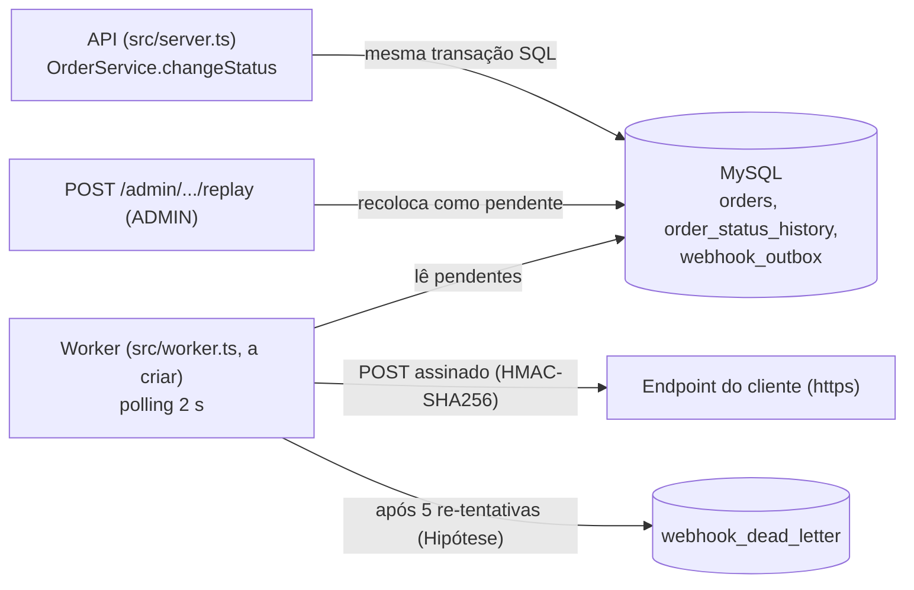

# RFC: Sistema de Webhooks de Notificação de Pedidos

## Metadados

| Campo | Valor |
| --- | --- |
| Autor | Larissa (Tech Lead) |
| Status | Em revisão |
| Data | 2026-10-11 |
| Revisores | Marcos (PM), Bruno (Eng. Pleno, Pedidos), Diego (Eng. Sênior, Plataforma), Sofia (Segurança) |
| Documentos relacionados | [PRD](PRD.md), [FDD](FDD.md), [ADRs](adrs/), [Tracker](TRACKER.md) |

Convenção: cada item tem ID em negrito e origem no formato `[hh:mm] Nome` (reunião técnica, `TRANSCRICAO.md`) ou caminho de código. O que não vem da reunião nem do código é marcado como **Hipótese**.

## Resumo executivo (TL;DR)

**RFC-TLDR**: propomos notificar clientes B2B por webhook (apenas saída) a cada mudança de status de pedido, em menos de 10 segundos ([09:02] Marcos). O evento é gravado numa tabela outbox do MySQL existente, na mesma transação do `changeStatus` ([ADR-001](adrs/ADR-001-outbox-no-mysql.md), [ADR-007](adrs/ADR-007-publicacao-do-evento-na-transacao-do-change-status.md)). Um worker em processo separado, com polling de 2 s, envia o HTTP ([ADR-002](adrs/ADR-002-worker-separado-em-polling.md)). Falhas têm retry com backoff 1m/5m/30m/2h/12h (contagem em RFC-OPEN-07) e DLQ em tabela própria ([ADR-003](adrs/ADR-003-retry-backoff-exponencial-e-dlq.md)). Cada envio é assinado com HMAC-SHA256, com secret por endpoint ([ADR-004](adrs/ADR-004-hmac-sha256-secret-por-endpoint.md)), e a entrega é at-least-once com `X-Event-Id` para dedup no cliente ([ADR-005](adrs/ADR-005-entrega-at-least-once-com-x-event-id.md)). Estimativa: 3 sprints, incluindo revisão de segurança ([09:47] Larissa). Pedimos revisão das alternativas descartadas e das questões em aberto, em especial as lacunas de especificação.

## Contexto e problema

- **RFC-CTX-01**: Atlas Comercial, MaxDistribuição e Nova Cargo pediram formalmente para ser notificados quando o status do pedido muda. Hoje fazem polling em `GET /orders`, o que deixa a integração lenta e cara ([09:00] Marcos).
- **RFC-CTX-02**: "tempo real" para esses clientes é qualquer coisa abaixo de 10 segundos ([09:02] Marcos).
- **RFC-CTX-03**: o escopo é só outbound; não há webhook de entrada ([09:02] Marcos, [09:03] Sofia).
- **RFC-CTX-04**: o código atual não tem eventos, filas nem processos em background. `changeStatus` em `src/modules/orders/order.service.ts` já é uma transação pesada: atualiza `orders`, insere em `order_status_history` e ajusta o estoque ([09:04] Bruno).
- **RFC-CTX-05**: pressão de prazo e de equipe: a Atlas pode migrar para um concorrente se não houver entrega até o fim do trimestre ([09:00] Marcos) e quer a feature para fim de novembro ([09:45] Marcos). O time é pequeno e evita infraestrutura nova ([09:07] Diego).

## Proposta técnica

- **RFC-PROP-01** (atomicidade): na transação do `changeStatus`, uma função `publishWebhookEvent(tx, ...)` insere o evento na `webhook_outbox`, filtrando pelos status que cada webhook quer ouvir. Commit registra o evento; rollback o descarta ([09:06] Diego, [09:40] Bruno, [09:41] Bruno). Ver [ADR-001](adrs/ADR-001-outbox-no-mysql.md) e [ADR-007](adrs/ADR-007-publicacao-do-evento-na-transacao-do-change-status.md).
- **RFC-PROP-02** (worker): nova entry-point `src/worker.ts` (a criar) e script `npm run worker`, processo separado da API, mesmo banco, `PrismaClient` próprio ([09:11] Larissa, [09:30] Bruno). Um único worker, que lê os pendentes mais antigos a cada 2 s ([09:09] Diego). Ver [ADR-002](adrs/ADR-002-worker-separado-em-polling.md).
- **RFC-PROP-03** (resiliência): timeout HTTP de 10 s ([09:42] Diego), retry com backoff exponencial 1m/5m/30m/2h/12h (5 re-tentativas, **Hipótese**, ver RFC-OPEN-07) e, esgotado o teto, DLQ em tabela separada com replay manual restrito a ADMIN e auditado ([09:17] Larissa, [09:18] Diego, [09:36] Sofia). Ver [ADR-003](adrs/ADR-003-retry-backoff-exponencial-e-dlq.md).
- **RFC-PROP-04** (segurança): HMAC-SHA256 sobre o corpo, secret única por endpoint gerada pela plataforma, rotação com grace de 24 h ([09:22] Sofia, [09:31] Marcos). Ver [ADR-004](adrs/ADR-004-hmac-sha256-secret-por-endpoint.md).
- **RFC-PROP-05** (garantia de entrega): at-least-once; o cliente deduplica pelo `X-Event-Id` ([09:25] Diego). Ver [ADR-005](adrs/ADR-005-entrega-at-least-once-com-x-event-id.md).
- **RFC-PROP-06** (evento): payload enxuto, sem `items`, renderizado como snapshot na inserção da outbox; limite de 64 KB com erro, sem truncar; URL do webhook obrigatoriamente https ([09:43] Diego, [09:52] Larissa, [09:24] Larissa, [09:23] Sofia). Ver [ADR-008](adrs/ADR-008-payload-snapshot-na-insercao-da-outbox.md).
- **RFC-PROP-07** (código): novo módulo `src/modules/webhooks` (a criar; controller, service, repository, routes, schemas), erros `WEBHOOK_*` sobre `AppError`, Pino, `errorMiddleware` e `requireRole` existentes ([09:27] Bruno, [09:29] Larissa, [09:30] Larissa). Ver [ADR-006](adrs/ADR-006-reuso-dos-padroes-do-projeto.md).
- **RFC-PROP-08** (superfície de API, resumo): CRUD de configuração por customer, filtro de eventos por status, rotação de secret, `GET /webhooks/:id/deliveries` (últimos 100) e replay de DLQ ([09:33] Bruno, [09:34] Marcos). Contratos, schemas e erros estão no [FDD](FDD.md).

## Alternativas consideradas

| ID | Alternativa | Trade-off que levou ao descarte | Fonte | ADR |
| --- | --- | --- | --- | --- |
| **RFC-ALT-01** | Webhook HTTP síncrono dentro do `changeStatus` | Cliente lento travaria a mudança de status de outros pedidos; cliente fora do ar não pode causar rollback | [09:04] Bruno, [09:06] Diego | [ADR-001](adrs/ADR-001-outbox-no-mysql.md), [ADR-007](adrs/ADR-007-publicacao-do-evento-na-transacao-do-change-status.md) |
| **RFC-ALT-02** | Redis Streams ou fila externa | Mais infraestrutura; Redis Cluster seria overengineering para um time pequeno | [09:07] Larissa, [09:07] Diego | [ADR-001](adrs/ADR-001-outbox-no-mysql.md) |
| **RFC-ALT-03** | Trigger do banco (estilo LISTEN/NOTIFY) para worker reativo | MySQL não tem listener nativo; trigger só executa SQL e não avisa processo externo; polling de 2 s já cumpre "menos de 10 s" | [09:09] Bruno, [09:09] Diego | [ADR-002](adrs/ADR-002-worker-separado-em-polling.md) |
| **RFC-ALT-04** | Worker dentro do processo da API | Reinício da API derrubaria o worker | [09:11] Diego | [ADR-002](adrs/ADR-002-worker-separado-em-polling.md) |
| **RFC-ALT-05** | Retry indefinido com backoff | Evento pendurado para sempre se o cliente sumiu | [09:15] Diego | [ADR-003](adrs/ADR-003-retry-backoff-exponencial-e-dlq.md) |
| **RFC-ALT-06** | Apenas 3 tentativas | Janela de cerca de 30 min mataria evento de cliente com 2 h de manutenção planejada | [09:16] Bruno, [09:16] Diego | [ADR-003](adrs/ADR-003-retry-backoff-exponencial-e-dlq.md) |
| **RFC-ALT-07** | DLQ como status "failed" na própria outbox | Tabela separada deixa a leitura da outbox mais limpa e serve de evidência para debug e replay ([09:18] Diego). No desenho do FDD a linha FAILED permanece na outbox como espelho e a `webhook_dead_letter` é a fonte de evidência e replay (**Hipótese** (FDD), ver FDD-FLX-07) | [09:17] Larissa, [09:18] Diego | [ADR-003](adrs/ADR-003-retry-backoff-exponencial-e-dlq.md) |
| **RFC-ALT-08** | Entrega exactly-once | Exigiria coordenação dos dois lados e seria muito mais complexa; at-least-once com `X-Event-Id` cobre "99% dos casos" | [09:25] Diego | [ADR-005](adrs/ADR-005-entrega-at-least-once-com-x-event-id.md) |
| **RFC-ALT-09** | Secret global da plataforma | Se vaza uma, vaza tudo | [09:21] Sofia | [ADR-004](adrs/ADR-004-hmac-sha256-secret-por-endpoint.md) |
| **RFC-ALT-10** | Guardar só `order_id` na outbox e renderizar no envio | Se o pedido mudar depois, o evento refletiria estado posterior em vez do estado de quando o status mudou | [09:51] Bruno, [09:52] Larissa | [ADR-008](adrs/ADR-008-payload-snapshot-na-insercao-da-outbox.md) |
| **RFC-ALT-11** | Id auto incremental na outbox | Foge do padrão do projeto, onde "tudo é uuid" | [09:51] Diego, [09:51] Larissa | [ADR-008](adrs/ADR-008-payload-snapshot-na-insercao-da-outbox.md) |
| **RFC-ALT-12** | Truncar payload acima do limite | Evento grande indica problema; preferido falhar com erro | [09:23] Sofia | [ADR-008](adrs/ADR-008-payload-snapshot-na-insercao-da-outbox.md) |

## Questões em aberto

Itens levantados na reunião e adiados ou não decididos. Nenhum é requisito desta fase.

- **RFC-OPEN-01**: rate limiting de saída por cliente (ex.: 50 pedidos mudando em 1 minuto). Fora do escopo: "observar e decidir depois" ([09:38] Diego, [09:39] Larissa).
- **RFC-OPEN-02**: email ou alerta ao cliente quando o webhook falha repetidamente. Fora desta fase, talvez na próxima após medir o impacto ([09:37] Larissa, [09:38] Marcos).
- **RFC-OPEN-03**: escala do worker e ordering com múltiplos workers (particionar por `order_id` ou lock pessimista). "Problema do futuro" ([09:12] Diego, [09:13] Diego).
- **RFC-OPEN-04**: arquivamento e retenção da outbox (entregues após cerca de 30 dias). Fora do escopo da feature ([09:08] Diego).
- **RFC-OPEN-05**: endurecer a permissão do CRUD de configuração, hoje qualquer role autenticada ([09:36] Marcos, [09:37] Sofia: "mais pra frente a gente pode endurecer").
- **RFC-OPEN-06**: nome do arquivo de processamento do worker, `webhook.worker.ts` ou `webhook.processor.ts` ([09:28] Bruno).

### Lacunas de especificação a fechar na revisão

Derivadas da análise da transcrição e do código, **não** levantadas na reunião como pendências. Pedimos decisão dos revisores.

- **RFC-OPEN-07**: contador de "5 tentativas". [09:17] Larissa fechou "5 tentativas" e [09:48] Larissa resumiu "total 5 tentativas"; a reunião não definiu se a 1ª entrega conta. Os 5 intervalos 1m/5m/30m/2h/12h somam 14h36m, compatíveis com "quase 15 horas entre primeira falha e última tentativa" ([09:17] Diego), o que só ocorre se a 1ª entrega NÃO conta (1 original + 5 retries). **Hipótese** a confirmar com Diego e Larissa.
- **RFC-OPEN-08**: formato da assinatura enviada ao cliente e o que entra no material assinado. A reunião só diz "HMAC sobre o corpo" ([09:22] Sofia). Detalhe no FDD. Revisor: Sofia.
- **RFC-OPEN-09**: rota de rotação de secret. A reunião fala só em "endpoint pro cliente pedir nova secret" ([09:21] Sofia); o FDD propõe uma rota como **Hipótese** de contrato.
- **RFC-OPEN-10**: como armazenar a secret, dado que a plataforma precisa dela para assinar. Não discutido na reunião; detalhe no FDD. Revisor: Sofia.
- **RFC-OPEN-11**: evento na criação do pedido. `create` em `src/modules/orders/order.service.ts` cria o pedido já `PENDING` e não passa por `changeStatus`; a reunião só trata mudança de status ([09:40] Bruno).
- **RFC-OPEN-12**: erro de payload acima de 64 KB dentro da transação aborta a mudança de status? Pela [ADR-007](adrs/ADR-007-publicacao-do-evento-na-transacao-do-change-status.md), falha na inserção faz rollback, mas a reunião não decidiu esse caso específico ([09:24] Larissa).
- **RFC-OPEN-13**: relação entre `X-Event-Id`, `event_id` do payload e `id` da linha da outbox: o mesmo UUID ou campos distintos ([09:25] Diego, [09:43] Diego, [09:51] Larissa).
- **RFC-OPEN-14**: papel de `WEBHOOK_INVALID_URL` versus `VALIDATION_ERROR` do Zod. [09:23] Sofia diz que `http://` é recusado como erro de validação no schema Zod, e [09:28] Bruno cita `WEBHOOK_INVALID_URL` entre os códigos; a reunião não reconciliou os dois. Ver FDD Q-03.

## Impacto e riscos

- **RFC-IMP-01** (código existente): `changeStatus` em `src/modules/orders/order.service.ts` ganha uma chamada a `publishWebhookEvent(tx, ...)` dentro da transação ([09:41] Bruno). Novos: `src/worker.ts`, `src/modules/webhooks`, tabelas `webhook_outbox`, `webhook_dead_letter` e de configuração (entregas: ver FDD), script `npm run worker`. Nenhuma mudança de contrato nos endpoints de orders; `errorMiddleware` não muda ([09:29] Bruno).
- **RFC-IMP-02** (operação): um processo novo para deploy, restart e monitoramento, com pool de conexões próprio ([09:11] Diego, [09:30] Bruno). Consulta ao MySQL a cada 2 s, mesmo sem eventos.
- **RFC-IMP-03** (cronograma): 3 sprints, com a revisão de segurança da Sofia (mínimo de 2 dias úteis, HMAC e geração de secret) no fim, antes do deploy ([09:46] Sofia, [09:47] Larissa). Meta de negócio: fim de novembro ([09:45] Marcos).
- **RFC-IMP-04** (limitação conhecida): sem ordering global; garantia só por `order_id` e enquanto houver um único worker ([09:13] Larissa). Clientes nunca pediram ordering global ([09:14] Marcos).
- **RFC-IMP-05** (risco): falha na outbox derruba a mudança de status. Mitigação: testes ponta a ponta no `changeStatus` ([09:46] Larissa) e decisão da RFC-OPEN-12.
- **RFC-IMP-06** (risco): crescimento da outbox sem arquivamento. Mitigação: índices em status e `created_at`, batch pequeno ([09:08] Diego); retenção em RFC-OPEN-04.
- **RFC-IMP-07** (risco): vazamento de secret, já ocorrido com um cliente ([09:22] Diego). Mitigação: secret por endpoint, rotação com grace de 24 h e revisão da Sofia. Proteção da secret nos logs: ver FDD.
- **RFC-IMP-08** (risco): duplicatas chegam ao cliente. Mitigação: `X-Event-Id` e documentação destacada no portal ([09:26] Marcos).
- **RFC-IMP-09** (risco): cliente fora do ar por mais de cerca de 15 horas só recupera o evento por replay manual ([09:17] Marcos aceitou). Mitigação: DLQ e replay ADMIN.
- **RFC-IMP-10** (risco, **Hipótese**): evento em retry pode ser ultrapassado por um evento posterior do mesmo pedido, pois o ordering só vale para a ordem de leitura. Não discutido na reunião; analisar no FDD.
- **RFC-IMP-11** (fora de escopo): email ao cliente, rate limiting de saída, dashboard visual (projeto do time de frontend, [09:40] Larissa), webhooks de entrada e arquivamento da outbox ([09:37] Larissa, [09:39] Diego, [09:02] Marcos, [09:08] Diego).

## Decisões relacionadas

- **RFC-ADR-01**: [ADR-001](adrs/ADR-001-outbox-no-mysql.md), padrão outbox no MySQL existente.
- **RFC-ADR-02**: [ADR-002](adrs/ADR-002-worker-separado-em-polling.md), worker em processo separado com polling de 2 s.
- **RFC-ADR-03**: [ADR-003](adrs/ADR-003-retry-backoff-exponencial-e-dlq.md), retry com backoff exponencial e DLQ em tabela separada.
- **RFC-ADR-04**: [ADR-004](adrs/ADR-004-hmac-sha256-secret-por-endpoint.md), HMAC-SHA256 com secret por endpoint e rotação com grace de 24 h.
- **RFC-ADR-05**: [ADR-005](adrs/ADR-005-entrega-at-least-once-com-x-event-id.md), entrega at-least-once com `X-Event-Id`.
- **RFC-ADR-06**: [ADR-006](adrs/ADR-006-reuso-dos-padroes-do-projeto.md), reuso dos padrões do projeto.
- **RFC-ADR-07**: [ADR-007](adrs/ADR-007-publicacao-do-evento-na-transacao-do-change-status.md), publicação do evento na transação do `changeStatus`.
- **RFC-ADR-08**: [ADR-008](adrs/ADR-008-payload-snapshot-na-insercao-da-outbox.md), payload como snapshot na inserção da outbox.
